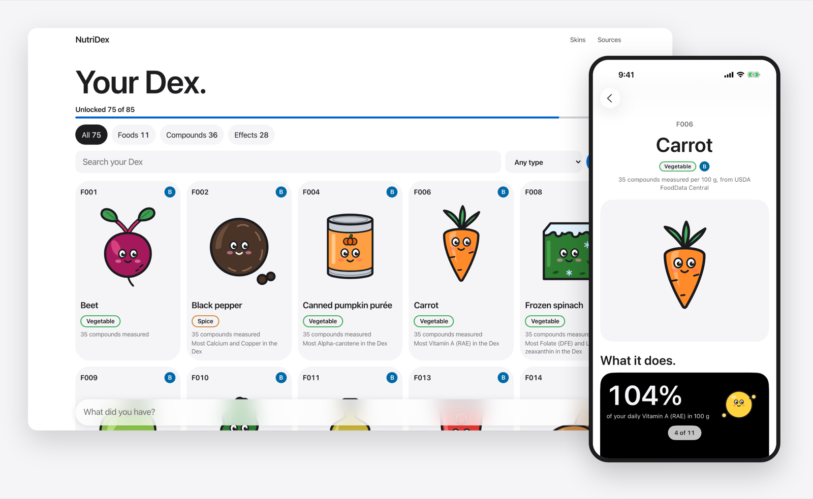
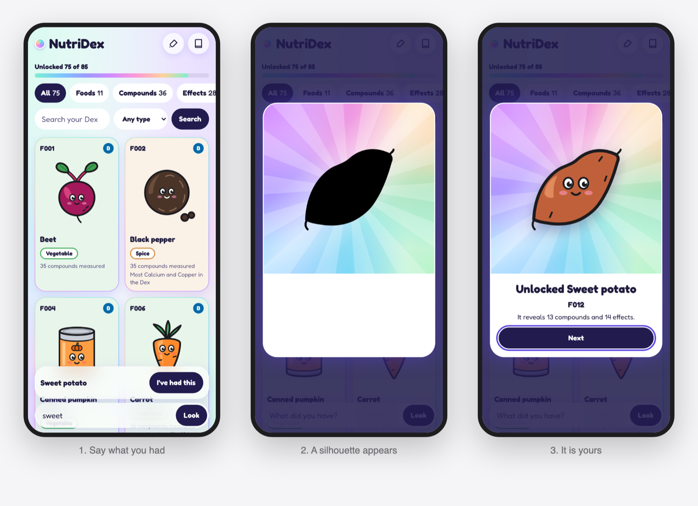
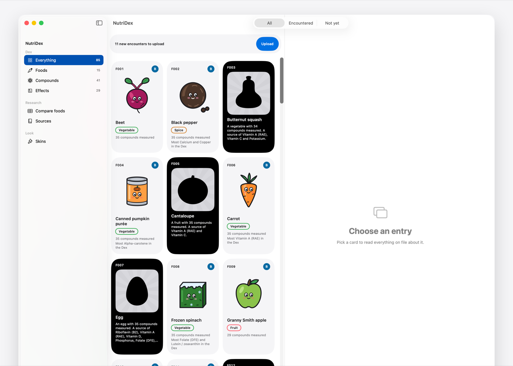
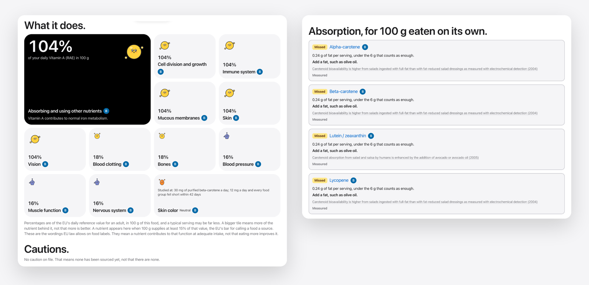
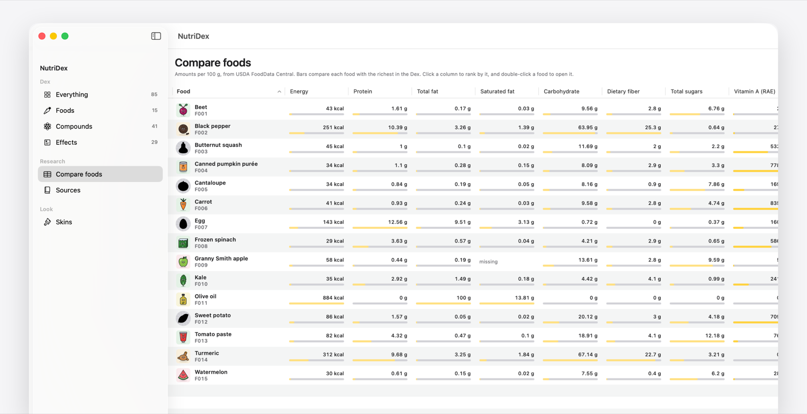
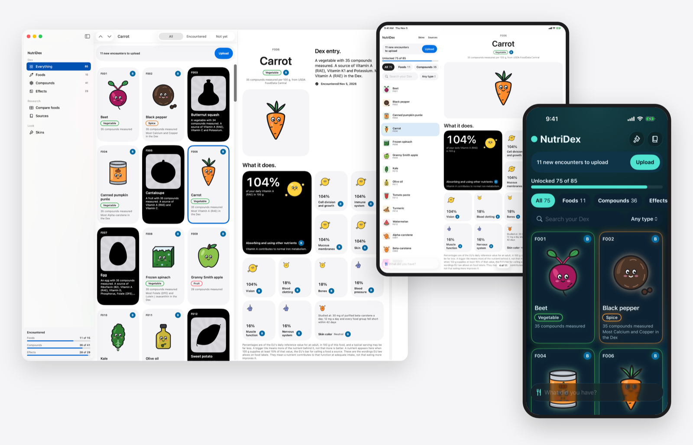
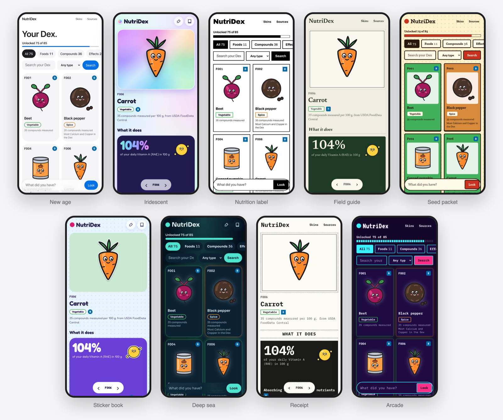
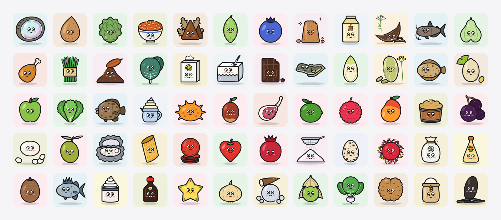
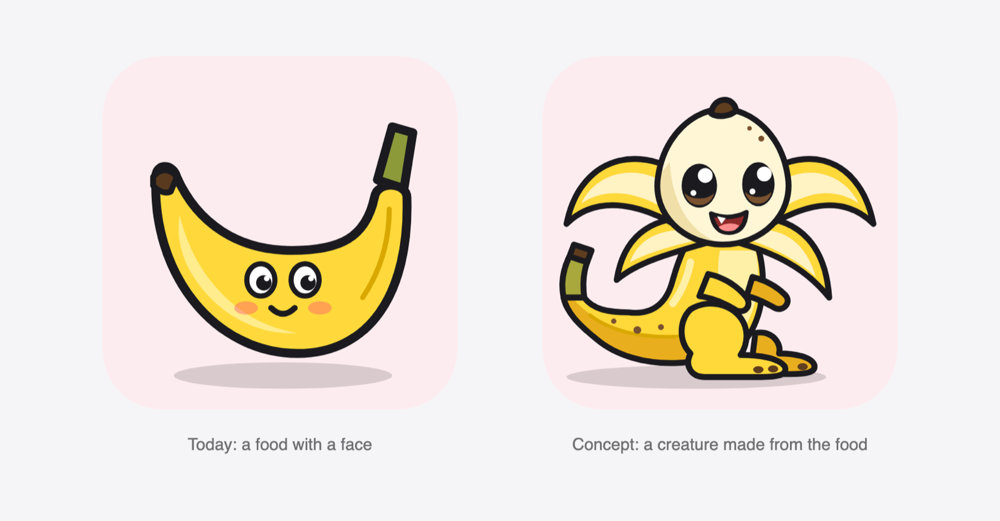
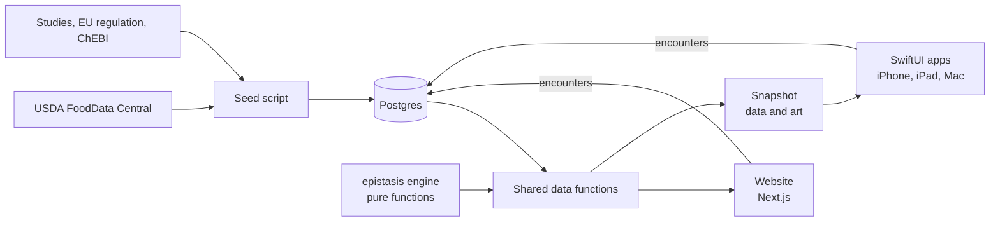

# NutriDex

**What is in your food, what it does, and what helps it work.**

NutriDex is a collection game built on a sourced nutrition database. Tell it what you ate and that food's creature
unlocks, along with the nutrients and compounds in it and what each one does. Every amount and claim traces back to
a source, and when nothing is known, the app says so instead of guessing.

> **Status:** an early working version, running on the web, iPhone, iPad and Mac.
> [Try it on the web](https://nutridex-8vtr.vercel.app). It is not on the App Store yet. I am looking for people to help build it: see [who I'm looking for](#who-im-looking-for).

## What makes it different

### You collect what you actually eat

Nothing shows until you have encountered it. You say what you had, upload it, and a silhouette turns into a creature.
Each food reveals the compounds it is a real source of and the effects they support, so what you learn follows what
is on your plate.

The Mac app is the home database. It shows the whole collection, blacks out what you have not found, and compares
foods side by side.

### It tells you what the food can do, and what it needs

Compounds are entries in their own right. Beta-carotene is one entry linked to every food that contains it, so its
absorption rules, prep effects and evidence apply everywhere it appears. A carrot's page says plainly that it has
0.24 g of fat per 100 g, under the 6 g that counts as enough to absorb its carotenoids, and suggests adding a fat
such as olive oil.

### It would rather say "we don't know"

Honesty is part of the design, and it shows in the app's own words:

- *"No caution on file. That means none has been sourced yet, not that there are none."*
- *"Where USDA has no value for this food it says missing, never zero."*
- *"They mean a nutrient contributes to that function at adequate intake, not that eating more improves it."*

Every effect, absorption rule and caution must carry a source and an evidence grade: the engine refuses to load one
without them, and a test fails if the database holds one. A rule extended to a whole chemical class is marked
"By class", so it never passes for something that was measured.

| Grade | Meaning | Typical sources |
| --- | --- | --- |
| **A** | Consistent human trials | Meta-analyses, multiple randomised trials |
| **B** | Some human evidence | A single trial, small trials, large cohort studies |
| **C** | Mechanistic only | Animal, in-vitro or cross-sectional studies |
| **D** | Traditional or anecdotal | Traditional use, testimonials, marketing |

### It is a real native app on every screen

The website is Next.js and the Apple apps are SwiftUI, with no web views. They share one dataset, so every platform
gives the same answers. Compare foods is one of the research tools on the Mac:

### It can look however you like

There are ten skins, each a row in one table of design tokens that web and native both read. Foods keep their true
colours in every one: a carrot is never green. Nine of the ten are shown here.

### Every food gets a creature

There are 456 original drawings so far. They were drawn by Claude, Anthropic's AI model, to a house style I approved.
This sample takes evenly spaced entries from the alphabetical list:

The next step is creatures built from the food's own anatomy, not a food with a face. This concept is the direction
I would most like an illustrator's help with:

## Where it stands

Counted on 2026-11-08, on version 0.7.0. The depth is the honest gap: the structure is ahead of the content.

| | |
| --- | --- |
| Foods in the game | 7,793, every food in USDA's SR Legacy, with 623,795 measured amounts |
| Compounds and nutrients | 152 |
| Effects | 29 |
| Effect claims | 140: 139 in the wording [EU Regulation 432/2012](https://www.legislation.gov.uk/eur/2012/432/annex) permits, 1 from a human study |
| Absorption rules | 2 |
| Cautions | 0 sourced so far |
| Household measures | 14,449 across 7,533 foods, from USDA: "1 medium carrot" is 61 g |
| Cooking retention factors | 7,018, the whole USDA retention table: 270 ways of cooking by 26 nutrients |
| Adult intake references | 184: the RDA or AI and the upper limit for 23 vitamins and minerals, 8 adult groups, from Health Canada |
| Creature drawings | 456, worn by 3,150 foods; the other 4,643 wear one of 21 category stand-ins |
| Skins | 10 |
| Automated checks | 948 unit tests passing |

## What's next

1. **Depth of evidence.** Add sourced cautions, more absorption rules and study-backed effects.
2. **Recipes.** The engine already works out what a recipe gives you, and it needs its builder and recipe screens.
3. **Paste a finding.** Paste a study, have AI draft the entries, and approve each one before it is saved.
4. **A public home.** Hosting, real accounts in place of the upload passcode, and a route to the App Store.
5. **Gut microbes and supplements.** The tables and engine checks exist, and they have no entries yet.

## Who I'm looking for

| Who | What you would shape |
| --- | --- |
| **Illustrator or character designer** | The creature style, and how one look stretches across thousands of foods |
| **Dietitian or nutrition scientist** | Evidence grades, how claims are worded, and the cautions that are missing today |
| **iOS / SwiftUI developer** | The Apple apps, all 7,793 foods running well on a real phone, and the route to the App Store |
| **Full-stack developer** | Hosting, accounts, the recipe builder and the paste-a-finding pipeline |
| **Game or product designer** | What makes collecting rewarding, and how it can reward curiosity without rewarding overeating |
| **Lawyer with health-app or IP experience** | The disclaimer, which is a draft that needs review before anyone else uses the app, and clearing the name |

**Interested?** Reach me through my GitHub profile, [@arscholtes](https://github.com/arscholtes).

## How it's made

I am building NutriDex on my own, with Claude Code as my coding partner, since October 2026. The commit history
shows which work it co-authored.

| Layer | Choice |
| --- | --- |
| Web | Next.js 16, React 19, TypeScript, Tailwind CSS |
| Apple | SwiftUI, with no React Native and no web views |
| Data | Postgres 16, Drizzle ORM, `pg_trgm` for fuzzy search |
| Engine | `epistasis`: pure TypeScript functions with no database access |
| Tests | Vitest and Xcode's test tools |

To run it, see [docs/DEVELOPMENT.md](docs/DEVELOPMENT.md). Every table is described in [SCHEMA.md](SCHEMA.md), and
every version in [CHANGELOG.md](CHANGELOG.md).

## Data sources

- **[USDA FoodData Central](https://fdc.nal.usda.gov/)**, for nutrient amounts. U.S. Department of Agriculture,
  Agricultural Research Service. FoodData Central, 2019. Published under
  [CC0 1.0](https://fdc.nal.usda.gov/api-guide/).
- **[ChEBI](https://www.ebi.ac.uk/chebi/)**, for chemical classes. EMBL-EBI, used under
  [CC BY 4.0](https://www.ebi.ac.uk/chebi/about).
- **[EU Regulation 432/2012](https://www.legislation.gov.uk/eur/2012/432/annex)**, for permitted health-claim wording.
- **Published studies**, each cited in the app with its limitations.

## Not medical advice

NutriDex is for general information and learning. It does not diagnose, treat, cure or prevent any disease, and it
does not replace advice from a doctor, registered dietitian or pharmacist.

## License

There is no open-source license yet, so all rights are reserved. Data from the sources above stays under its own terms.
