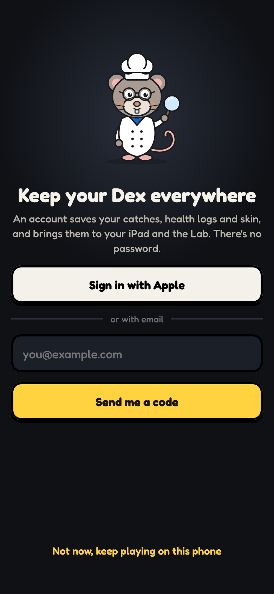
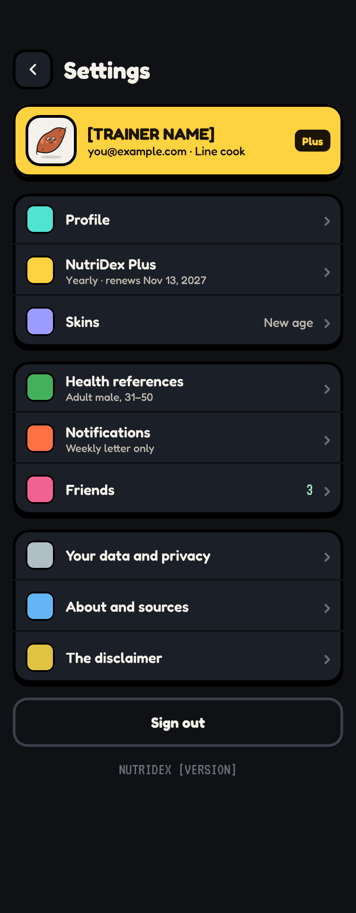
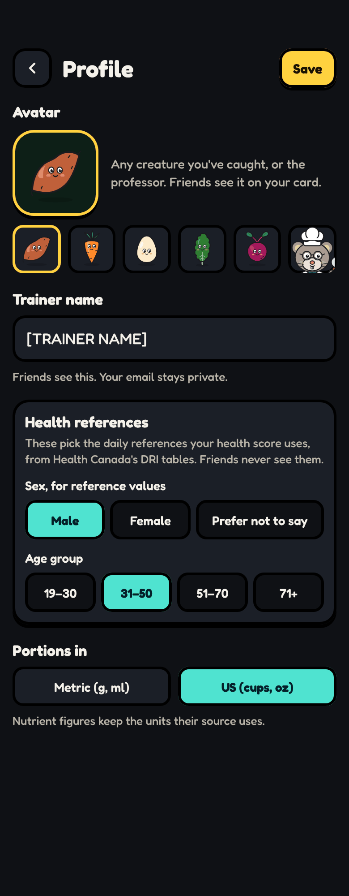
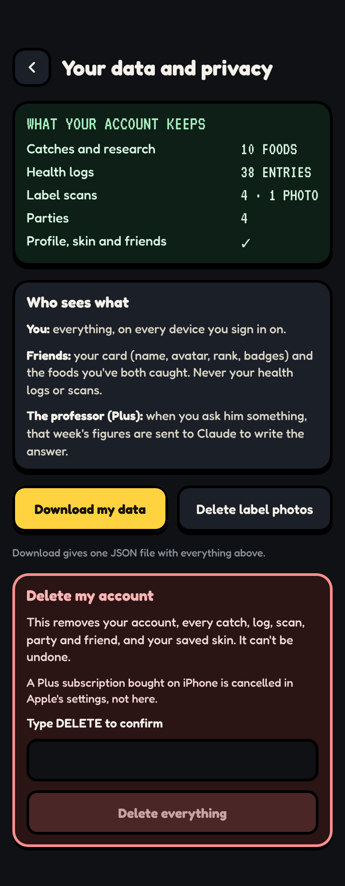
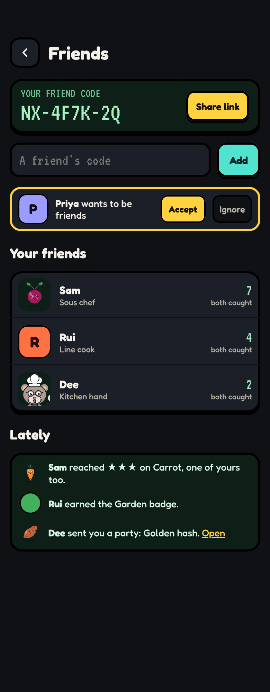
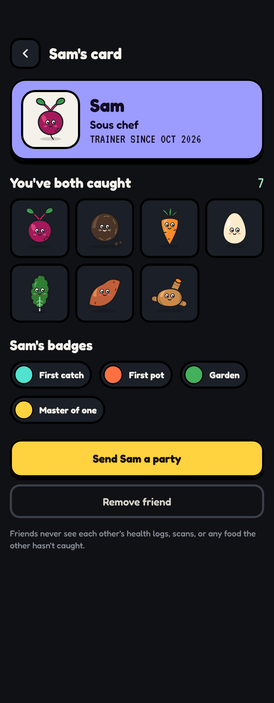
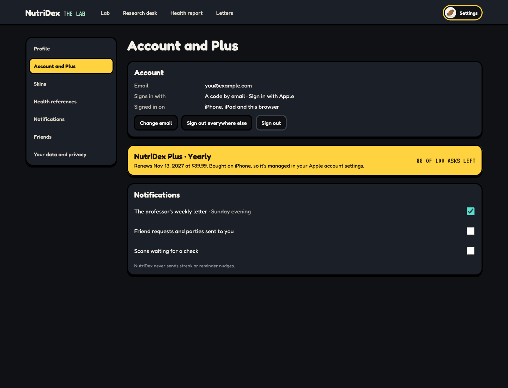

# Account

_Last updated 2026-11-13. Source: the [design canvas](https://claude.ai/code/artifact/ab065fd4-9113-4368-b970-3f623da00a00)._

Signing in, settings, profile, your data, and friends. The gear on the trainer card opens Settings. Friends follow the same rule as the rest of the game: nothing you haven't caught shows, and nobody sees anyone's health data.

**DECISIONS FOR YOU**

1. Sign-in stays passwordless, as the web does today: email, then a 6-digit code. On iPhone and iPad, Sign in with Apple sits above it; it is optional, but it's the fastest path there. No Google or Facebook, so there's nothing else to maintain.

2. An account is never required to play. Without one, your Dex lives on the device; signing in later merges it in. Plus and friends need an account.

3. Friends see your trainer card (name, avatar, rank, badges, joined date) and the foods you've both caught. Never your health data, never your logs, and never a count of anything they haven't caught. Seeing a friend's catch can't reveal a food you haven't found: their card shows only foods you've caught too.

4. No contacts upload and no search by name. You add friends by code or by a link you share, so nobody can find you without you handing them something.

### iPhone · Sign in, interactive

**BUILD NOTE · Sign in (interactive)**

Three states: choose a way in, enter the code, signed in. Email gets a 6-digit code (the web's existing flow in lib/auth/sign-in.ts); if there's no account it makes one, so there is no separate sign-up.

Sign in with Apple on Apple devices. The code field uses one-time-code autofill. Wrong code: say so and keep the email; resend unlocks after 30 seconds.

After signing in, anything caught on this device while signed out uploads and merges, and the professor says how many foods came along.

### iPhone · Settings

**BUILD NOTE · Settings**

Reached from the trainer card's gear button. Rows open their own screens: Profile, Plus, Skins, Health references, Notifications, Friends, Your data and privacy, About and sources, the disclaimer, and Sign out.

Notifications are all off by default except the weekly letter for Plus members. There are no streak or guilt reminders, ever. Signed out, the account row becomes 'Sign in to keep your Dex everywhere'.

### iPhone · Profile

**BUILD NOTE · Profile**

Trainer name (shown to friends), avatar (any creature you've caught, or the professor), and your reference group. Sex and age group pick the Health Canada DRI row the health score uses; the screen says exactly that, and 'Prefer not to say' uses the higher of the two values for each nutrient, with a note that the score is approximate. Units: metric or US, for portions only. Figures stay in the units their source uses.

### iPhone · Your data and privacy

**BUILD NOTE · Your data and privacy**

What's stored, in plain words: your catches, logs, scans (photos only if you kept them), parties, profile and friends. Download gives one JSON file (the existing /settings/data route, extended). Label photos can be deleted on their own.

Delete account removes everything and can't be undone; it asks you to type DELETE. On iPhone the screen reminds you that an Apple subscription is cancelled in Apple's settings, not here.

### iPhone · Friends

**BUILD NOTE · Friends**

Your friend code and a share link at the top; add by code below. The list shows each friend's avatar, name, rank, and how many foods you've both caught.

The feed only shows events about foods you've caught too, plus badges and rank-ups, so a friend can never reveal a hidden entry. Friend requests need accepting; removing a friend is silent. Shared parties (recipes) arrive as invitations you can save.

A friend's avatar shows as a creature only if you've caught that food too; otherwise it's their initial.

### iPhone · A friend’s card

**BUILD NOTE · A friend's card**

Their trainer card: avatar, name, rank, badges, joined date, and the foods you've both caught. Actions: send a party (a recipe), or remove them.

Never shown: health score, logs, scans, their total count, or any food you haven't caught.

## Web and Mac

### Web and Mac · Settings

**BUILD NOTE · Web and Mac settings**

The same sections in a left-hand list with the chosen one beside it; the web's existing Settings page (skin, account, sign out, download, delete) grows into this. Plus is managed through Stripe on the web, and through Apple when it was bought on iPhone, and the page says which.

On iPad, Settings is the same as on iPhone in a split view: the list on the left, the section on the right.
