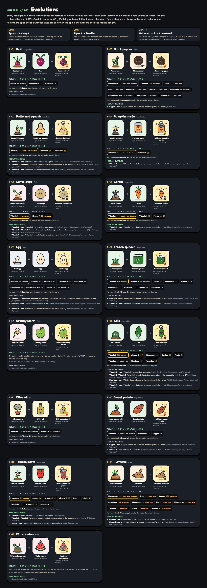
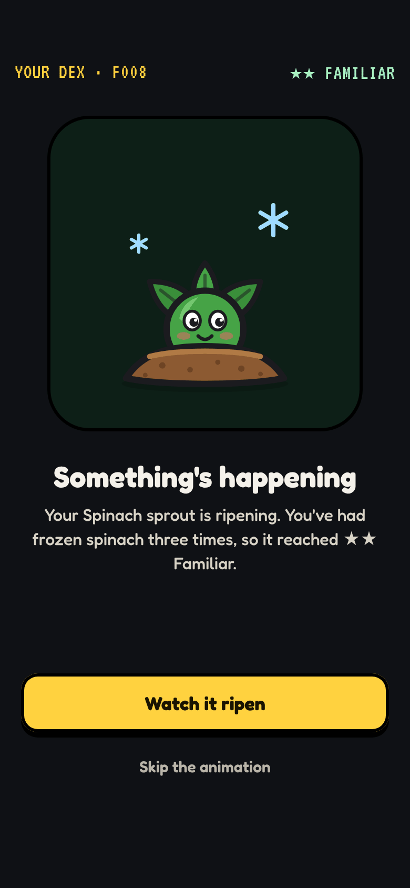
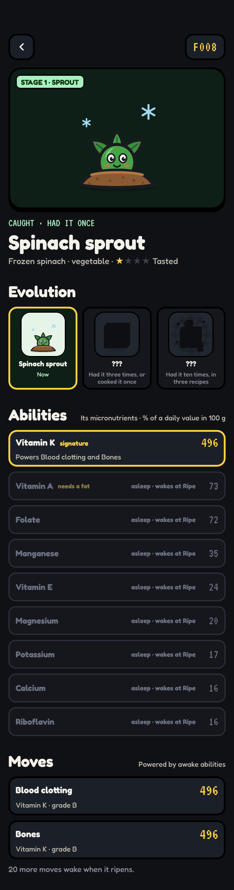

# Evolutions

_Last updated 2026-11-14. Source: the [design canvas](https://claude.ai/code/artifact/ab065fd4-9113-4368-b970-3f623da00a00)._

**EVOLUTIONS**

Every food grows in three stages as you research it: where it starts (a sprout, a blossom, a sapling, a nest), the food itself, and Heirloom. Its abilities are its micronutrients: each vitamin or mineral it's a real source of. Evolving wakes abilities; it never changes a figure. They were always in the food, and now you know them.

**DECISIONS FOR YOU**

1. One entry, three looks. A food keeps one Dex number through its stages; stage 1 shows where it starts and its figures stay the USDA record of the food itself. Heirloom is a rank, not a variety.

2. When it evolves. I tied the stages to the research tiers you already have: Sprout at ★ (caught), Ripe at ★★ Familiar, Heirloom at ★★★★ Mastered. No new grind.

3. Two foods have no ability. Granny Smith and watermelon don't clear a bar for any micronutrient (Granny Smith's vitamin C is missing from its USDA record; watermelon's is under the bar). I show "No ability yet" rather than invent one.

4. The old Ability (fat-soluble) becomes a trait on the vitamin A ability, where it belongs. Cautions stay never-locked.

### Evolutions: every food's line

**BUILD NOTE · Evolution lines (spec)**

This sheet shows all fifteen lines for design. In the app a line appears only once the food is caught, and a stage you haven't reached is a silhouette with its condition ("Had it three times, or cooked it once").

Abilities: vitamins, minerals and choline the food clears a bar for (15% of a daily value in 100 g), largest share first. The first is its signature: the one a sprout has awake. Traits: "needs a fat" (carotenoid vitamin A, rule id-0001) and "spoon food" (spices and oils). Pairings wake at Heirloom: the EU claims that link one nutrient to another (vitamin C increases iron absorption; vitamin D helps absorb calcium and phosphorus; copper, riboflavin and vitamin A for iron; zinc for vitamin A; vitamin C and vitamin E). In the World, a pairing lets two party members act in one turn.

Art: stage 1 is a new drawing in the house style; stage 3 is the stage-2 art with the heirloom toque, medal and halo, so a new food needs one extra drawing.

### iPhone · A food ripens, interactive

_Interactive on the canvas: press Play._

**BUILD NOTE · A food ripens (interactive)**

Plays in the unlock queue after Upload, or right away on the device that crossed the tier. 3.2 s: three glow pulses, the two stages swap faster and faster, a white flash, the reveal. Haptic success at the reveal. Reduce Motion: a 0.4 s crossfade. Skippable; never cancellable (the food has already ripened).

The reveal lists the abilities that woke and the moves they bring, and says plainly that nothing about the food changed.

### iPhone · Abilities on an entry (Frozen spinach, a sprout)

**BUILD NOTE · Abilities on an entry**

The Evolution strip sits under the research card: three stages, the current one ringed, the next as a silhouette with its condition. Abilities replace the old single Ability: each micronutrient with its share and what it powers. Asleep ones are named (the food is caught, so they're unlocked) but greyed until the next stage.

The same change ships on iPad (entry panel) and the web and Mac (research desk).
