# Explorations

_Last updated 2026-11-13. Source: the [design canvas](https://claude.ai/code/artifact/ab065fd4-9113-4368-b970-3f623da00a00)._

Earlier rounds, kept for reference. The game design superseded the three directions; the Field journal recipe screen's step grid lives on in the iPad party screen.

## Journey map

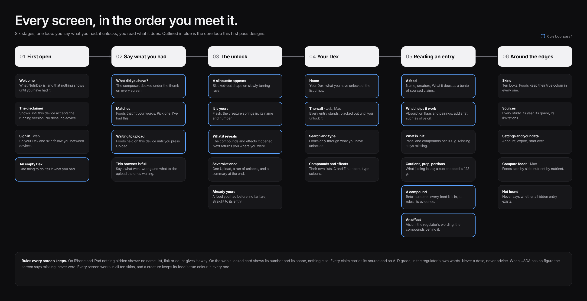

## A · Living wall

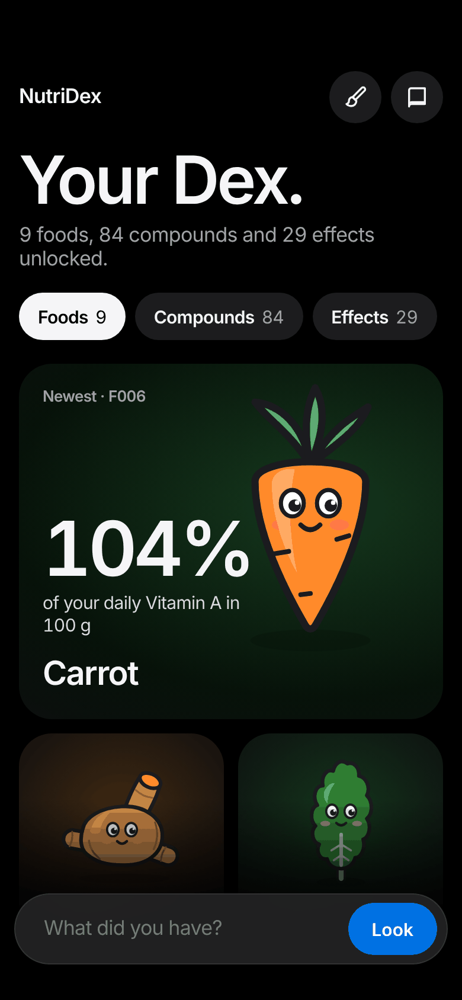 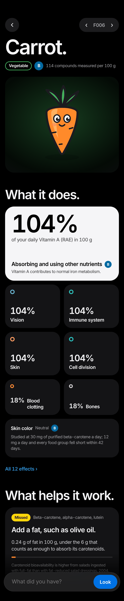

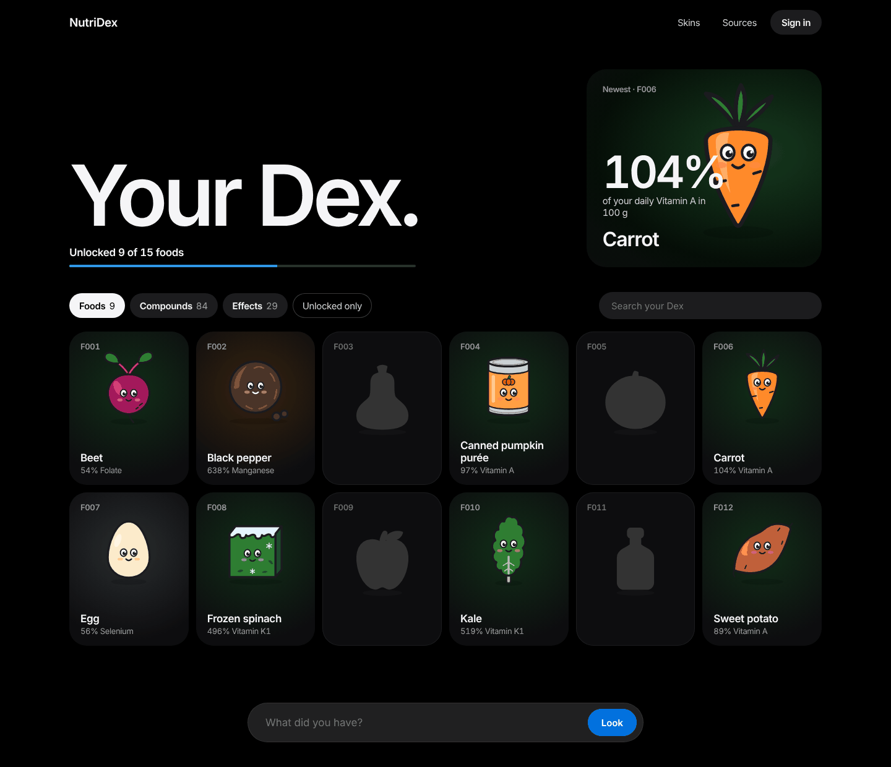

## B · Field journal

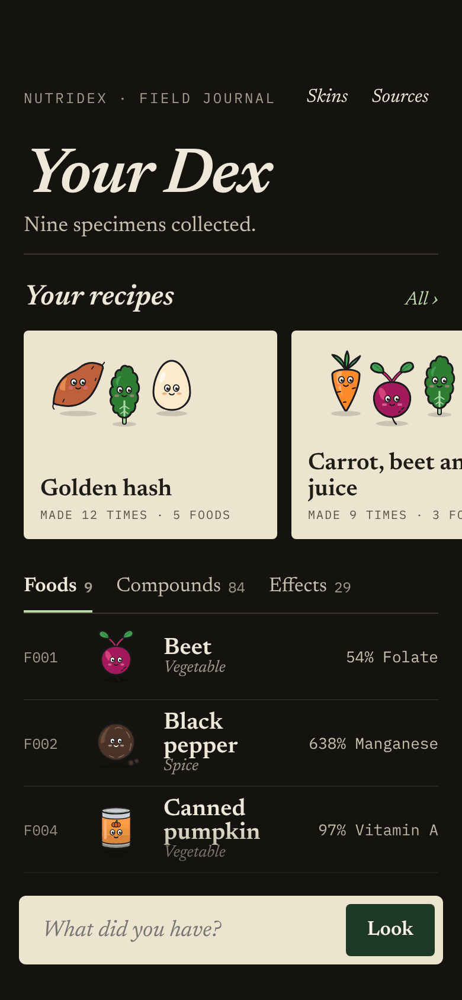 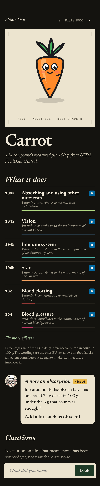 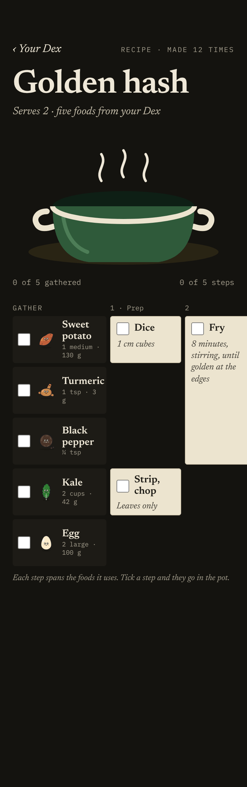

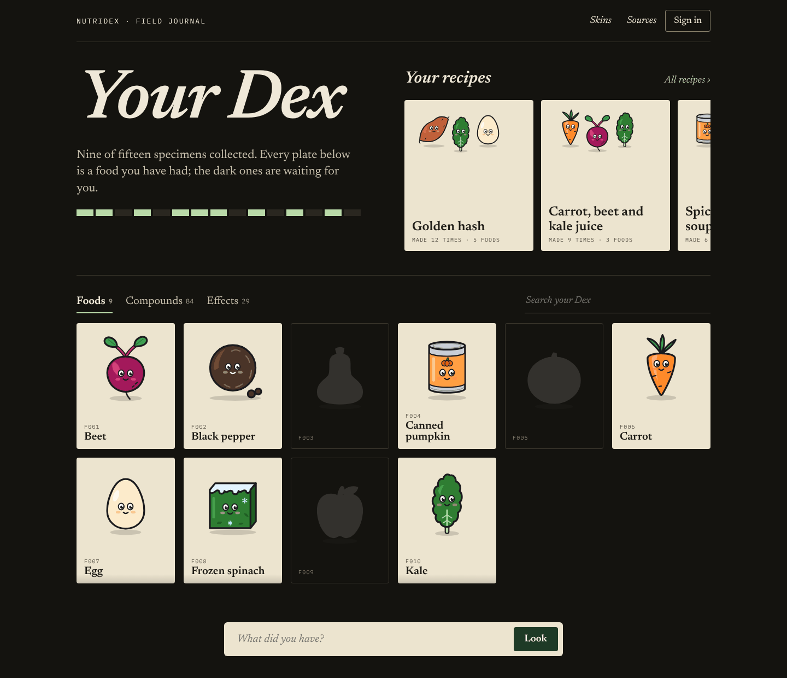

## C · Night market

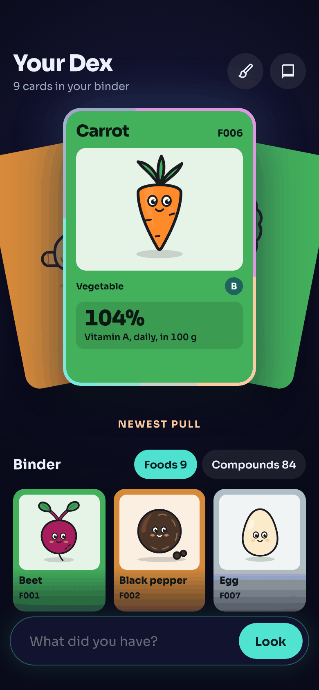 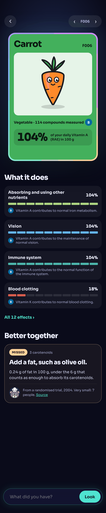

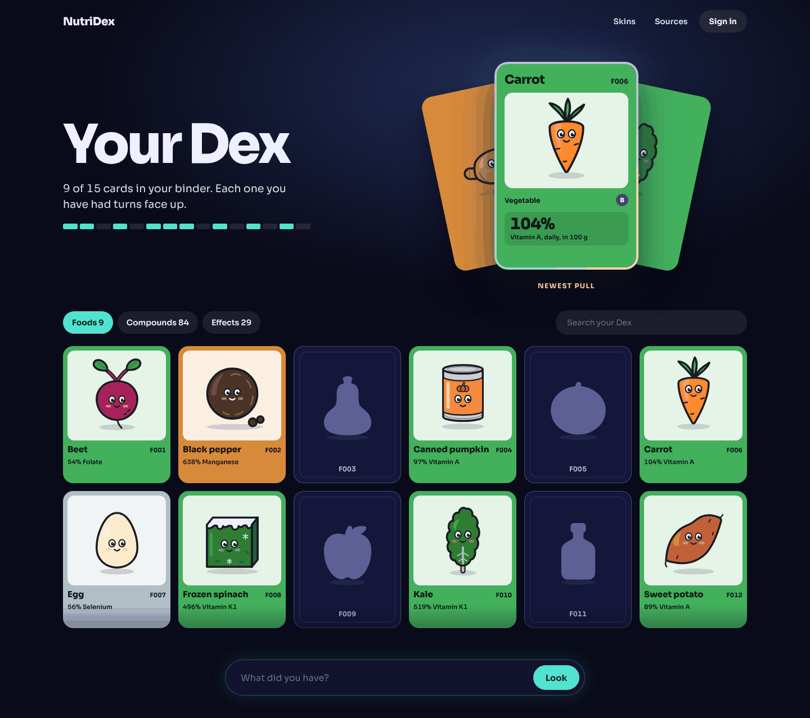
