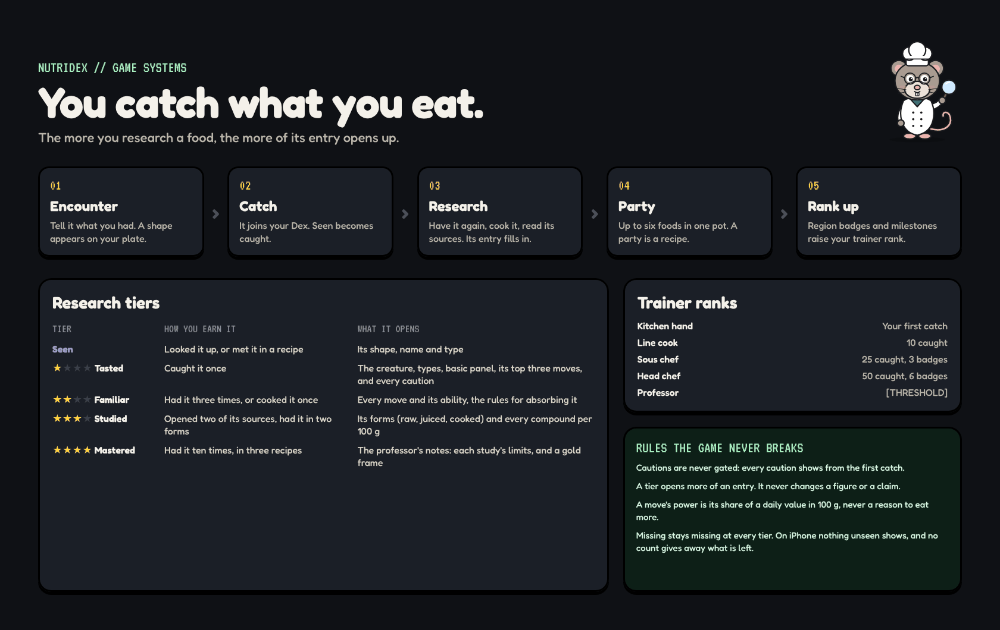

# Game systems

_Last updated 2026-11-13. Source: the [design canvas](https://claude.ai/code/artifact/ab065fd4-9113-4368-b970-3f623da00a00)._

How catching, research, parties and ranks fit together.

**BUILD NOTE · How the systems connect**

Every catch writes one encounter row: food, form (raw, juiced, cooked), time, device, and the recipe if there was one. Tiers are never stored. They are worked out from those rows plus 'source opened' events, so changing a threshold re-ranks everyone fairly.

Thresholds live in one table (tier, task, count) that the engine reads, the way SKINS works today. Badges are rules over the same rows: region and count, first recipe cooked, a combo met. Rank comes from caught count and badges.

Seen means you searched for it or it was in a recipe you opened.

Figures and cautions ignore tiers completely: a tier only decides which sections draw. The professor's lines are fixed strings keyed by event (empty Dex, rank up, missing data), never generated advice.
