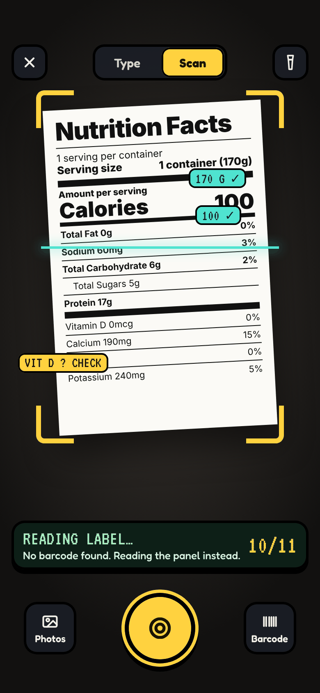
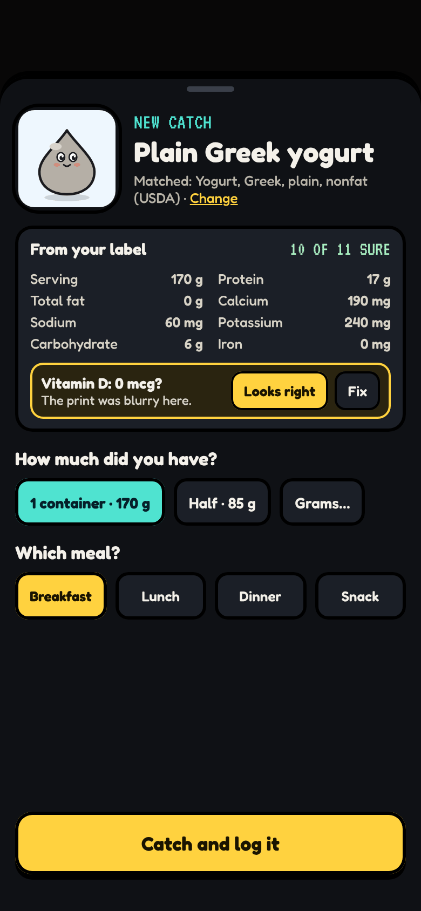
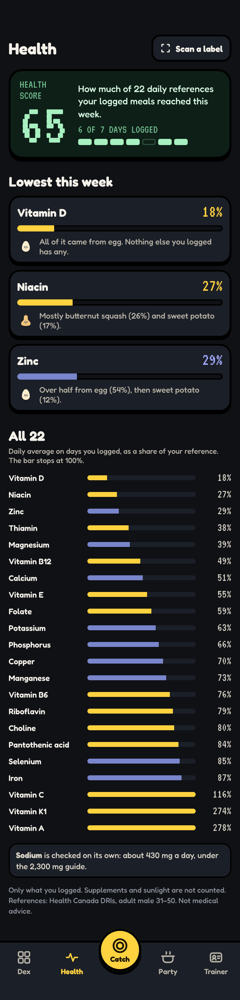
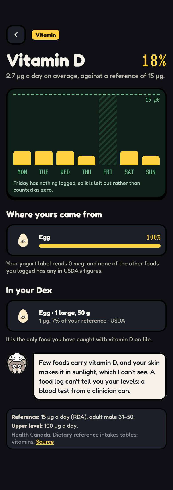

# Health

_Last updated 2026-11-13. Source: the [design canvas](https://claude.ai/code/artifact/ab065fd4-9113-4368-b970-3f623da00a00)._

Take a picture of a label (or scan its barcode) every time you eat, and NutriDex logs it. A health score shows how much of your daily references your logged meals reached, and the lowest nutrients come first, with where yours came from.

The figures on these screens are worked out from the repository's real data: USDA amounts from the native snapshot, Health Canada's DRIs from `data/seed/intake-references.ts`, and a sample week of logs. The yogurt label is a sample.

**HOW THE SCORE WORKS · Build note**

The health score is the average, over 22 nutrients, of how much of your daily reference your logged meals reached. Each nutrient is capped at 100% and averaged over the days in the last week you logged anything.

The references are Health Canada's DRIs, already in data/seed/intake-references.ts, chosen by the sex and age group set on the trainer card (adult male 31–50 shown).

Sodium is left out of the average. It is checked against its 2,300 mg CDRR instead, so going over shows a notice and going under never does. A UL notice shows only where the UL applies to food: vitamin A's is for preformed vitamin A, so carrots never trip it.

Amounts are USDA's per 100 g times the grams you logged. A scanned label's own figures are used for that product, marked 'From your label'. A value USDA doesn't have stays missing, never zero, and the nutrient shows as partial. With fewer than three logged days the score reads 'Not enough yet'.

The screens' figures are worked out from the repo's real data and a sample week of logs.

**DECISIONS FOR YOU**

This section bends two house rules, so it's worth deciding on purpose.

1. 'Never advice.' The insights say which nutrients your logs fall short on and which of your caught foods carry them, per portion. They never say 'eat more' and never give a dose, but this is the closest the app comes to advice. It deserves a line in the disclaimer and a version bump.

2. 'Nothing hidden leaks.' Insights name only foods you've caught, so no hidden entry is given away on iPhone or iPad.

A single 'health' number can read like a verdict. I framed it as coverage of daily references, kept calories out of it entirely (CLAUDE.md says another app owns energy targets), used no red, no streak pressure and no praise or blame, and pointed to a clinician for actual testing.

### iPhone · Scan a label

**BUILD NOTE · Scan**

Catch opens with two modes, Type and Scan. Scan tries the barcode first and looks it up in USDA's Branded Foods (the seed already holds branded entries). A match means USDA figures and a category stand-in creature.

With no barcode, or no match, it reads the Nutrition Facts panel on the device (iOS Vision text recognition), field by field, each with a confidence. Low-confidence fields are flagged for a check, here or later in the Lab.

The photo stays on the device unless you choose to keep it with the scan. The label in this mock is a sample.

### iPhone · Log what you had

**BUILD NOTE · Log**

After a scan or a typed food: how much did you have? Portions come from the label's serving or USDA's portion weights (usda-portions.json), plus a grams field.

Logging writes one encounter row with grams, meal, form and source (USDA, or your label). A new food still plays the catch; a known one gets +1 research.

The meal (breakfast, lunch, dinner, snack) lets the score tell whether a day was fully logged.

### iPhone · Health score

**BUILD NOTE · Health**

Health replaces Map in the phone tab bar; the map moves to a toggle at the top of the Dex.

The LCD shows the score and how many days it rests on. The three lowest nutrients come first, with where yours came from. Then all 22 bars, lowest first, filled to 100% of the reference; past 100% only the number grows.

Colours stay neutral: no red for low, no green for high. One line always shows: only what you logged; supplements and sunlight are not counted.

### iPhone · Nutrient detail

**BUILD NOTE · Nutrient detail (vitamin D)**

Seven days against the reference line; an empty day shows as a gap, never as zero. Then where yours came from, by food, and the caught foods in your Dex that carry it, per their usual portion, from USDA.

The reference row shows its source and UL. A line points to a clinician for a blood test, since a food log can't measure your levels. No dose and no supplement, ever.

iPad and web versions: see [[iPad|iPad]] (Health) and [[Web and Mac|Web-and-Mac]] (health report and scan review).
