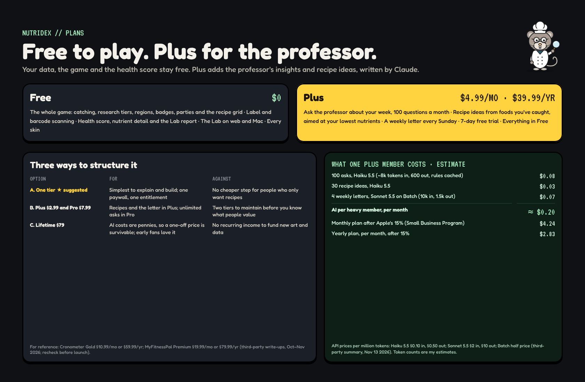
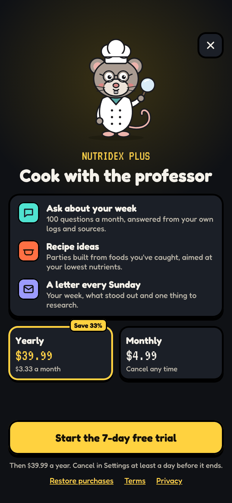
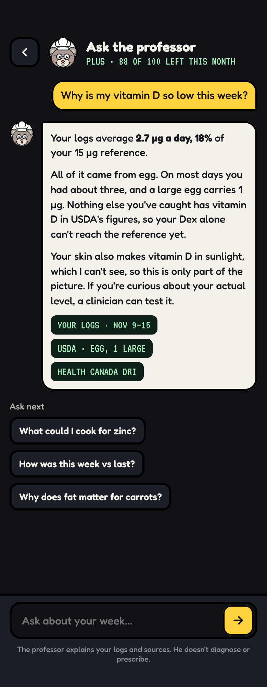
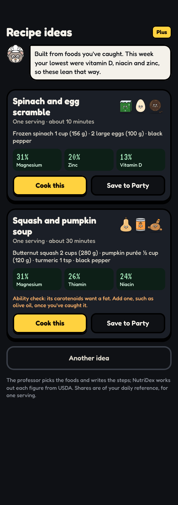

# NutriDex Plus

_Last updated 2026-11-13. Source: the [design canvas](https://claude.ai/code/artifact/ab065fd4-9113-4368-b970-3f623da00a00)._

The paid tier: the professor's insights about your week and recipe ideas, written by Claude. The game, scanning and the health score stay free.

**HOW CLAUDE IS USED · Build note**

The engine does the maths; Claude writes the words. Every number Claude sees comes from the engine (the week's nutrient table, the caught list, sources and grades), and every number on screen is drawn from that table, never from the model's text. A reply that quotes a figure the table doesn't hold is rejected and retried.

The model sees only caught foods, so it can't leak a hidden entry. Recipe ideas use caught foods only.

The system prompt holds the house rules: no doses, no supplements, no diagnosis, the regulator's wording for claims, 'missing stays missing', and to say when the logs are too thin to judge. Health questions beyond food point to a clinician.

The static part of the prompt (rules, sources) is cached. The weekly letter runs on the Batch API at half price.

Models: Haiku for quick asks and recipe ideas, Sonnet for the weekly letter. Calls go through app/api/ask on our server; the API key never reaches a device.

**DECISIONS FOR YOU**

1. Price. I'd start with one tier at $4.99 a month or $39.99 a year, with a 7-day trial. That is under Cronometer Gold ($59.99 a year) and MyFitnessPal Premium ($79.99 a year), which fits a new app, and AI costs leave plenty of margin (see the sheet).

2. What stays free. I kept the whole game, scanning and the health score free. Paying buys the professor's voice and recipe ideas, not your own data.

3. The professor's lines were fixed strings. Plus makes him generative for paid users, held to the rules in the blue note.

4. On iPhone, subscriptions must go through Apple's in-app purchase; the web can use Stripe. One account, one entitlement on our server.

Competitor prices are from third-party write-ups (Oct–Nov 2026) and should be rechecked before launch.

### iPhone · NutriDex Plus

**BUILD NOTE · Paywall**

Shown when a free user taps Ask, a recipe idea, or the weekly letter, never on launch and never mid-catch. The professor explains what Plus adds in his own voice.

Plans: monthly and yearly, yearly preselected, with a 7-day trial. Restore purchases and terms are required by Apple. Prices come from StoreKit, never hard-coded, so they show in the local currency.

Closing it returns you exactly where you were.

### iPhone · Ask the professor

**BUILD NOTE · Ask the professor**

A chat grounded in your week. Suggested questions come from the score (your lowest nutrients). Replies cite what they rest on as chips: your logs, a USDA figure, a source with its grade. Tapping a chip opens it.

The counter shows questions left this month (100 on Plus). The answer here is real: it uses the computed week, the only vitamin D source logged, and the egg's USDA portion figure.

### iPhone · Recipe suggestions

**BUILD NOTE · Recipe ideas**

Parties the professor would cook from foods you've caught. Claude picks the foods and writes the steps; the engine computes what one serving brings, and those numbers are the ones shown (real USDA figures here).

Ideas lean toward your lowest nutrients but never say you must eat them. 'Cook this' opens the recipe grid; saving keeps it in Party. Locked foods are never suggested, so nothing hidden leaks.

The weekly letter is on the [[Web and Mac|Web-and-Mac]] page.
