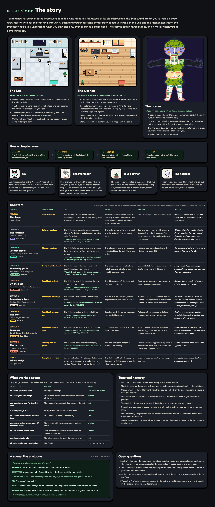
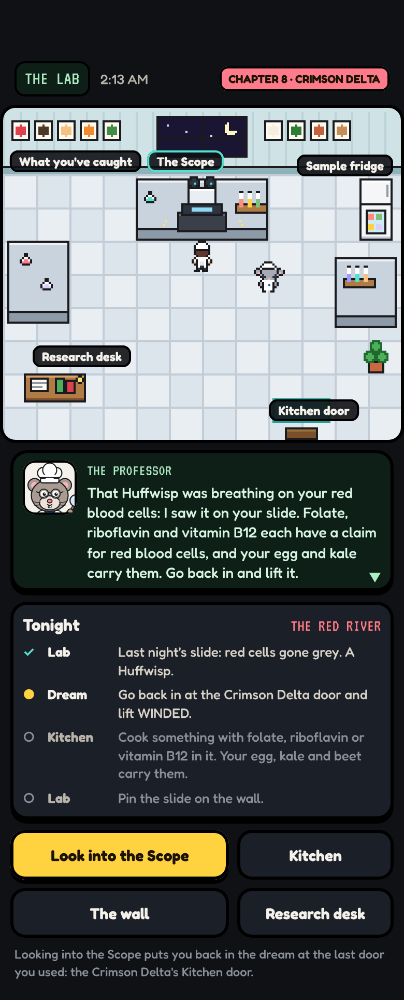
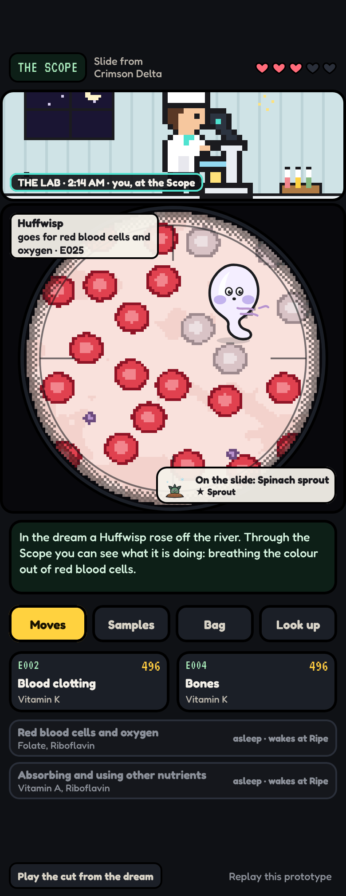
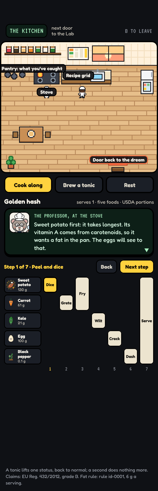

# The story

_Last updated 2026-11-14. Source: the [design canvas](https://claude.ai/code/artifact/ab065fd4-9113-4368-b970-3f623da00a00)._

Awake, you are a scientist in the Professor's food lab. Asleep at its old microscope, the Scope, you dream the World inside a body. The Lab and the Kitchen are real places, always in colour, and they are where the story happens: the Professor talks to you there, and the Kitchen is where you cook along with him. Encounters happen at the Scope, on a slide of the land's own tissue.

### The story

**BUILD NOTE · The story**

Scenes live in data/world/story.json: each has a place (Lab, Kitchen or dream), a trigger, and 3 to 6 lines. The triggers are things the player really did, read from the same events the app already records (an encounter, a recipe cooked, a source opened, a tier crossed, a status lifted, a trial cleared). lib/world/ decides which scene is due; the apps only play it. Lines may name only caught foods and unlocked nutrients, and a claim is quoted from the card word for word; a test checks every line against both.

The web and Mac Lab home gains a "Tonight" card (see the Lab on the Game page). iPhone and iPad get the Lab screen. Same lines everywhere.

### iPhone · The Lab

**BUILD NOTE · The Lab (iPhone)**

The Lab, 12×10 tiles at 2×: the Scope on its bench, the wall (only what you've caught: no empty frames on iPhone and iPad), benches, the sample fridge, the research desk, the Kitchen door. You and the Professor walk here like the dream, so the same movement code runs it.

The story scene plays when you come in, then "Tonight" lists the chapter's beats. Look into the Scope: a 0.6 s push into the eyepiece, then you're in the dream at the last door you used. On web and Mac the same scene and card sit on the Lab home.

### iPhone · At the Scope, interactive

_Interactive on the canvas: pick a move, swap a sample, look up._

**BUILD NOTE · At the Scope (iPhone, interactive)**

The cut: the dream ripples, the Lab at night (you bent over the Scope), then a push into the eyepiece; with Reduce Motion, a crossfade. Above: the bench, so you always see where you are. Middle: the slide at 3×, the hazard's house-style drawing over the cells it's at, the name plate and the sample on the slide.

Rules as before: a move is one of the sample's jobs; the right job blocks and the cells come back. Spinach is a sprout, so only vitamin K is awake; swap to Egg, Beet or Kale. Look up fails only while WINDED. Power is shown but never changes the result.

### iPhone · The Kitchen, interactive

_Interactive on the canvas: cook along, brew a tonic, or rest._

**BUILD NOTE · The Kitchen (iPhone, interactive)**

One room reached from every coral roof. Cook along is for real cooking: open a recipe in NutriDex and the Kitchen comes up beside it. The recipe grid (ingredients as rows, a column per step, each step spanning the ingredients it uses) lights the step you're on, and the Professor's line for it is built from the engine's flags: here the fat rule (rule id-0001), met by two eggs at 10 g of fat a serving. At the end you can bottle one tonic its foods lift.

Brew a tonic: the bench as before. Rest: hearts and statuses, then back to sleep at the door you came in by.

The Lab's home screen on the web and Mac carries the night's chapter in a Tonight card: see [[Web and Mac|Web-and-Mac]].
