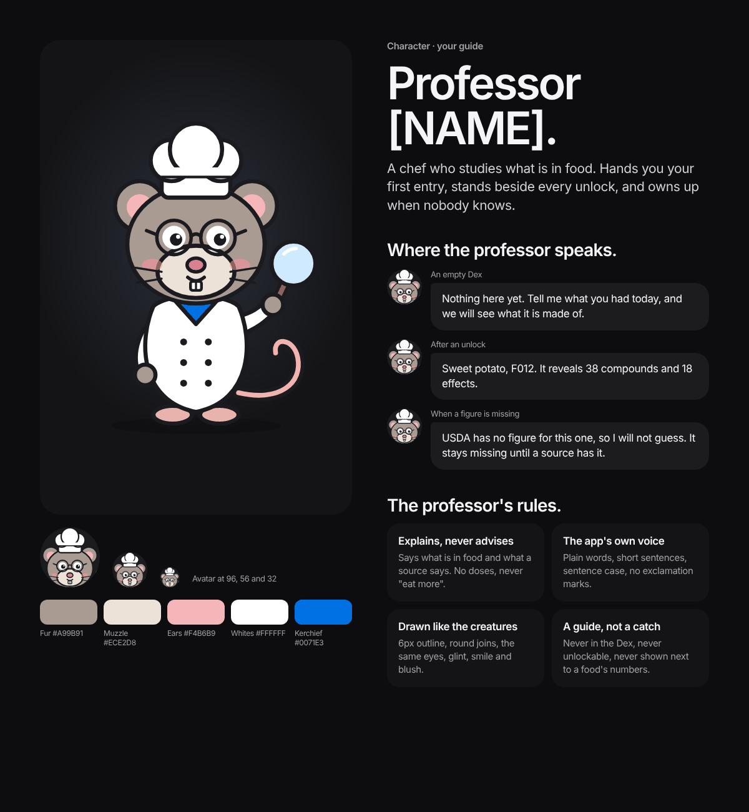

# The professor

_Last updated 2026-11-13. Source: the [design canvas](https://claude.ai/code/artifact/ab065fd4-9113-4368-b970-3f623da00a00)._

An original chef rat, drawn in the creatures' house style, who guides people through the Dex. He has a [NAME] placeholder.

Rules: he explains and never advises; he speaks in the app's voice (plain words, sentence case, no exclamation marks); he's drawn like the creatures; and he is never in the Dex or unlockable. Outside Plus his lines are fixed strings keyed by event. With Plus he becomes generative, held to the rules on the [[Plus|Plus]] page.
