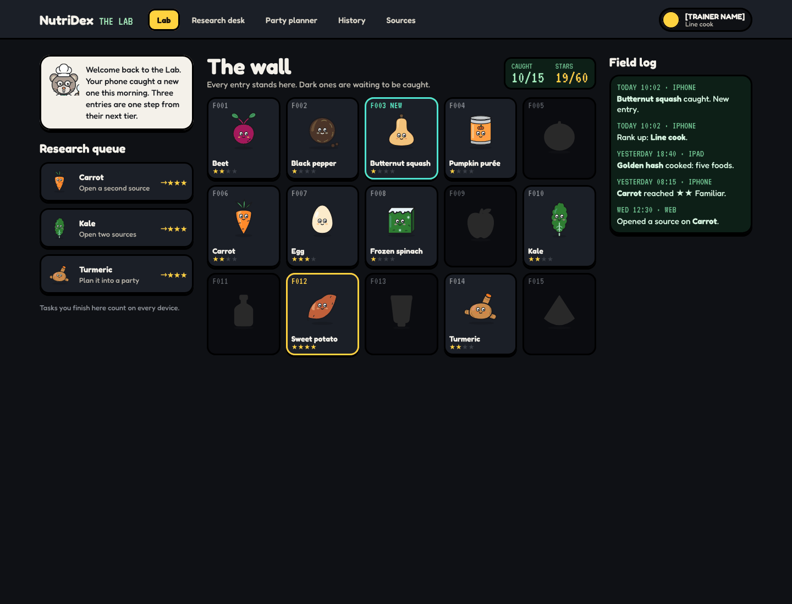
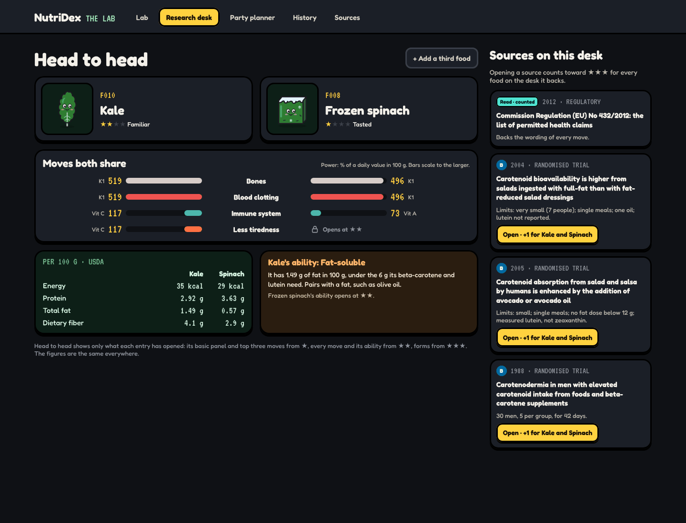
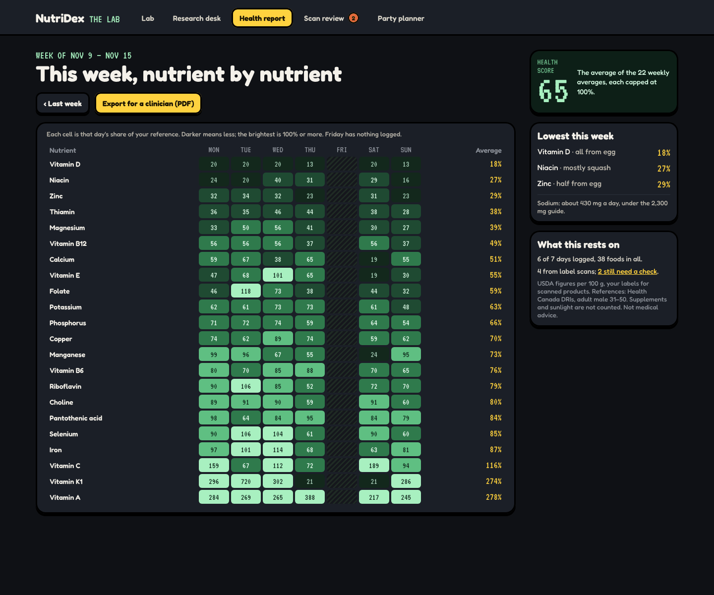
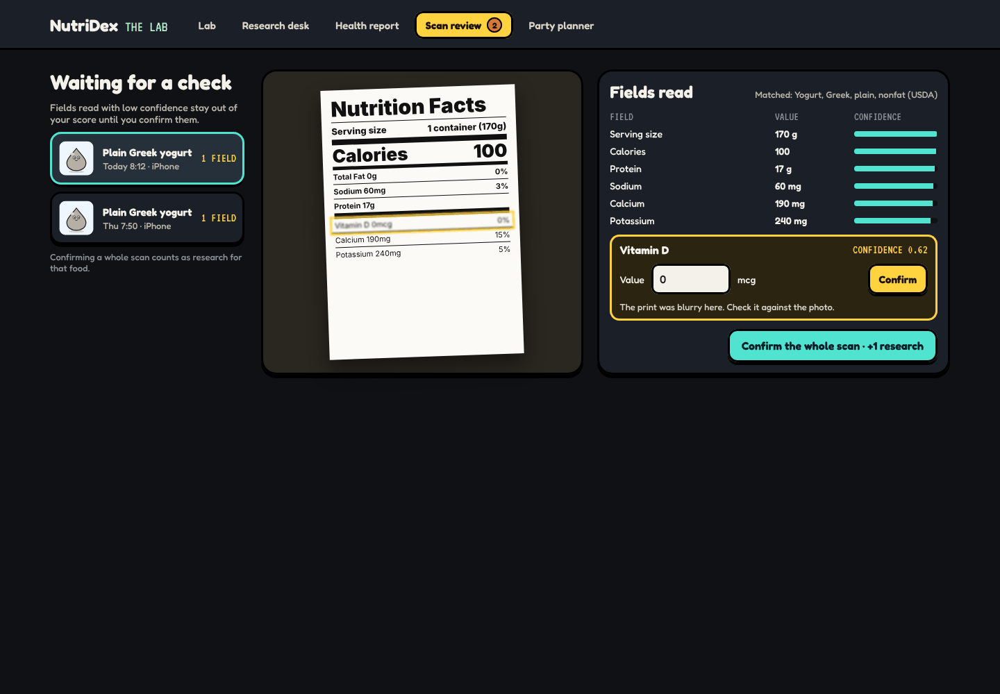
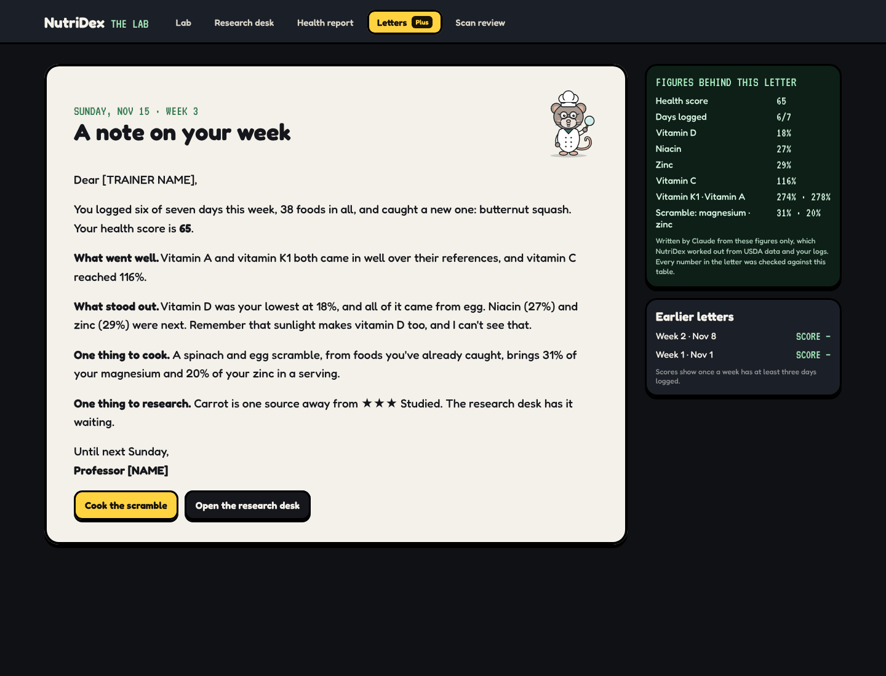

# Web and Mac: the Lab

_Last updated 2026-11-13. Source: the [design canvas](https://claude.ai/code/artifact/ab065fd4-9113-4368-b970-3f623da00a00)._

**CONCEPT · Field and Lab**

The phone is the field: you catch. The web and Mac are the Lab: you research, plan and look back.

Lab work counts as real research, so the two feed each other. Reading a source on the web ticks 'open a second source' on the phone's entry, and a party planned on the web is ready to cook on the phone or iPad.

Only the Lab shows the whole wall: every entry, blacked out until caught, number and shape only, as the web does today. Same account, same rows, synced live.

### Web and Mac · the Lab

**BUILD NOTE · The Lab**

Three columns. The research queue lists open tasks, ordered by how close each food is to its next tier. The wall shows every entry: caught ones in colour with stars, the rest blacked out with only a number and shape. The field log lists recent catches synced from your phone, with device and time.

Clicking a task opens the research desk at the right source. The wall is the web's existing wall view (components/wall.tsx), restyled, and keeps its rule that a locked card gives nothing away.

### Web and Mac · research desk

**BUILD NOTE · Research desk**

Compare up to three caught foods side by side: the Mac's compare, in game form. It shows moves by power, the ability, and the panel per 100 g.

The right pane lists the sources behind what is on screen, with study type, year, size and limitations. Opening one counts toward 'open two sources', but only after it has been open for a few seconds, so it can't be farmed by clicking.

Sections follow the same tiers as on the phone, and figures are the same everywhere.

### Web and Mac · Lab report

**BUILD NOTE · Lab report**

The week as a grid: 22 nutrients down, seven days across, each cell shaded by its share of the reference in one hue, lighter to darker. An empty day is hatched.

Clicking a row opens that nutrient. Export makes a PDF to take to a clinician, with references and sources printed on it. The report shows what you logged, never conclusions about your health.

### Web and Mac · Scan review

**BUILD NOTE · Scan review**

Label scans with a low-confidence field land here, oldest first. The photo sits beside the fields it produced, each with its confidence; fix or confirm, and the logged meal updates.

A field below 0.8 confidence stays out of the score until it is checked. Confirming a whole scan counts as research for that food.

### Web and Mac · weekly letter

**BUILD NOTE · Weekly letter**

Every Sunday night a Batch API job writes each Plus member a letter about their week: what went in, what stood out, one recipe idea, and a research task for the Lab. It's delivered in the Lab and as a notification, and kept in an archive.

It quotes only figures from the engine's weekly table, which sits beside it so every claim can be checked. If fewer than three days were logged, it says so and keeps it short.
