# The World

_Last updated 2026-11-14. Source: the [design canvas](https://claude.ai/code/artifact/ab065fd4-9113-4368-b970-3f623da00a00)._

**THE WORLD: A BODY, IN A DREAM**

Awake, you're a scientist in the Professor's food lab. Asleep at its old microscope, the Scope, you dream you're inside a body: eight lands, each where its part of the body is, round Market Town in the belly (where food comes in). Hazards knock one job in the body out of balance with a status. When one finds you, the dream cuts to the Lab: you at the Scope, the hazard on a slide of the tissue it goes for. The only fix is a move or a tonic for that same job, built from foods you've really caught, and it only takes you back to normal.

The Lab and the Kitchen next door are real places, always in colour, and the story happens in them (see "The story"). Everything here comes from the Dex's own data: the EU health claims (Reg. 432/2012, grade B), the bars (15% of a daily value in 100 g), the carotenoid fat rule, USDA portions. Game numbers (steps, hearts, frames) are rules, written down on "How the World plays".

**DECISIONS FOR YOU**

1. A body, not an island. The eight lands now sit where their part of the body is, so the World is its own place and not an island like Pokémon's. The old features stay: the eye lake became two eyes, the bay became the mouth (the fort guards the throat), the harbour sits in the chest between the lungs, the delta is the pelvis, the canyon runs down one arm to a fist, the dunes down the other to an open hand, the cliffs down both legs.

2. No battle screen. Encounters happen at the Scope: the same rules as before (Moves, Samples, Bag, Look up), drawn as you at the microscope and a slide of the tissue the hazard goes for. The slide is always in colour; only the dream fades.

3. The Kitchen is a place. Every coral roof in the dream is a door into one real Kitchen next to the Lab, where you brew, rest and cook along. Cooking a real recipe can bottle one tonic, by the same check as the bench. Tell me if cooking shouldn't make tonics.

4. The Professor is the one voice: in the Lab, at the stove, and over the Scope in the dream. Your partner only speaks in the dream, and is never cooked.

5. Whose body? The finale says "Yours. Mine. Anyone's. Same jobs." The dream is never a picture of your own health; a faded land means not yet understood.

6. Kept from before: World replaces Party in the tab bar; spoon foods can't lift a status alone; the disclaimer gains a line (statuses aren't conditions, tonics aren't treatments), with a version bump.

## Web and Mac

### Web and Mac · The World atlas, interactive

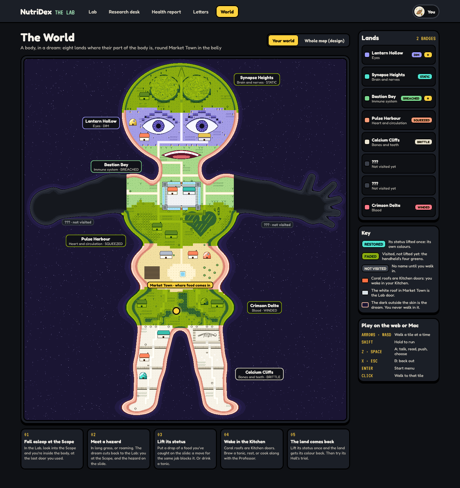

_Interactive on the canvas: pick a land._

**BUILD NOTE · Atlas (web and Mac)**

The whole body at 8 px a tile (1008×1128, the 132×143 map cropped to the body with a margin of the dream's dark), drawn at whole-number scale with smoothing off. "Your world" shows restored lands in colour, faded lands in the four greens, and fog over lands you haven't entered (no name, "???"). The toggle's second view is for design review only; the app never shows the whole map.

The skin round the body is drawn along a smooth outline from a distance field stored in the map, so every renderer draws the same edge; collision stays per tile. Labels are HTML in the dark beside each part of the body, never baked into the art. The yellow dot is you. Click a land (map or list) for its guide.

## The eight lands

### Web and Mac · Land 1: Lantern Hollow

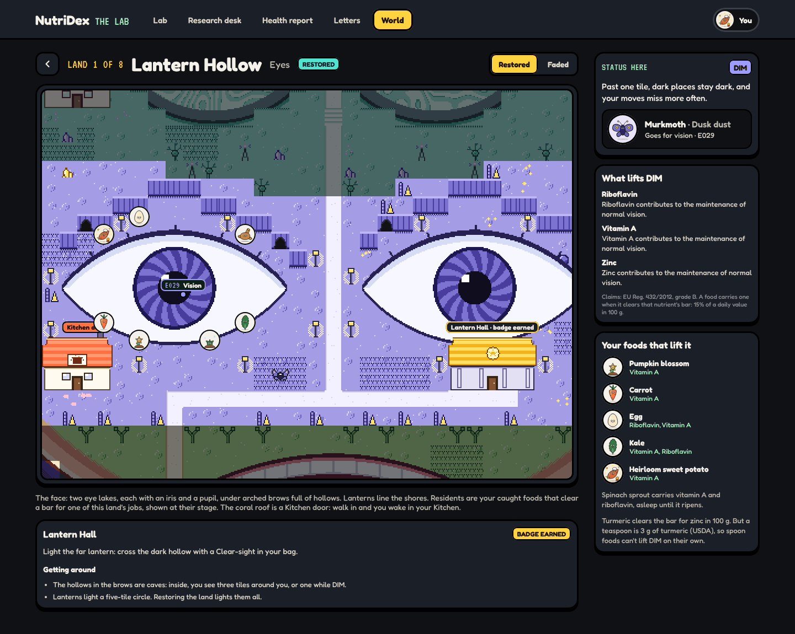

**BUILD NOTE · Lantern Hollow (Eyes)**

The face. Two eye lakes, each with an iris and a pupil, drawn along their own outlines; the brows above are ridges with hollows (caves) at their ends. Cave floors are dark: you see 3 tiles around you, or 1 while DIM (a circular light mask, 4 px dithered edge). Lanterns light a 5-tile circle; restoring the land lights them all. Trial: cross the dark hollow to the far lantern with a Clear-sight in your bag; the route has 3 set Murkmoths.

The map is 30×22 tiles of the one body, at 2×; neighbouring lands are dimmed. District tags are the land's jobs (effects); the one its status hits is ringed in the status colour. Residents are your caught foods at their stage. The Restored/Faded toggle shows both looks.

### Web and Mac · Land 2: Synapse Heights

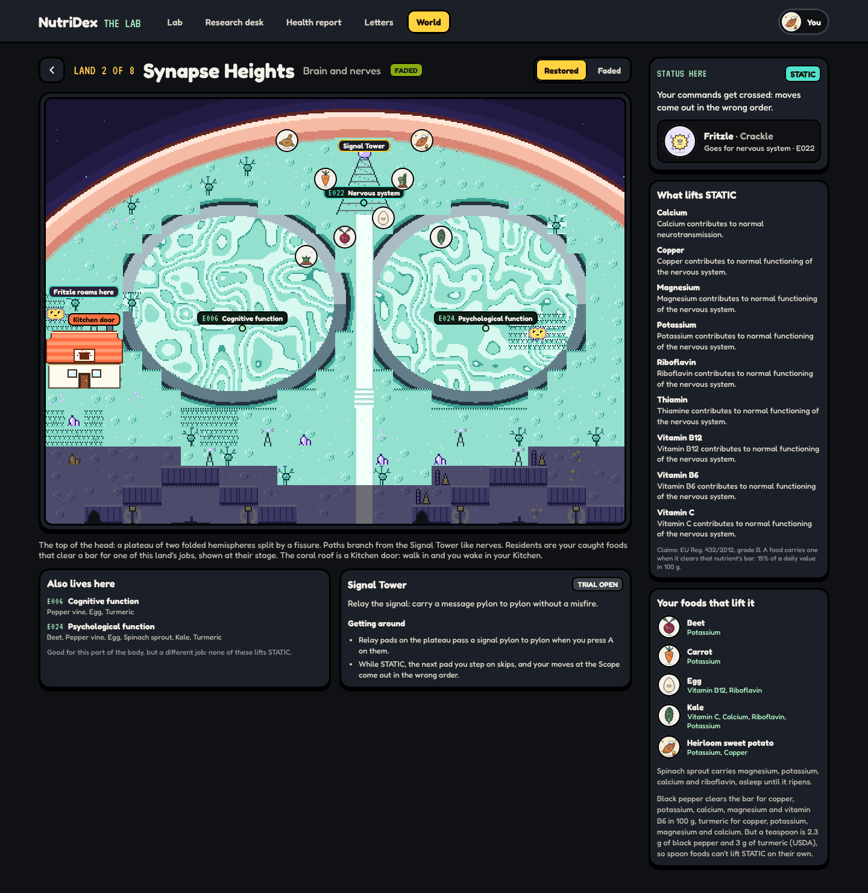

**BUILD NOTE · Synapse Heights (Brain and nerves)**

The top of the head. Two folded hemispheres split by a fissure, with the Signal Tower at its top. Relay pads on the plateau: press A to pass the signal along the pylons. While STATIC, the next pad skips and your moves at the Scope come out in a shuffled order. The plateau rim is cliff, with stairs where the fissure path climbs it. Trial: relay a message across six pads without a misfire.

The map is 30×22 tiles of the one body, at 2×; neighbouring lands are dimmed. District tags are the land's jobs (effects); the one its status hits is ringed in the status colour. Residents are your caught foods at their stage. The Restored/Faded toggle shows both looks.

### Web and Mac · Land 3: Bastion Bay

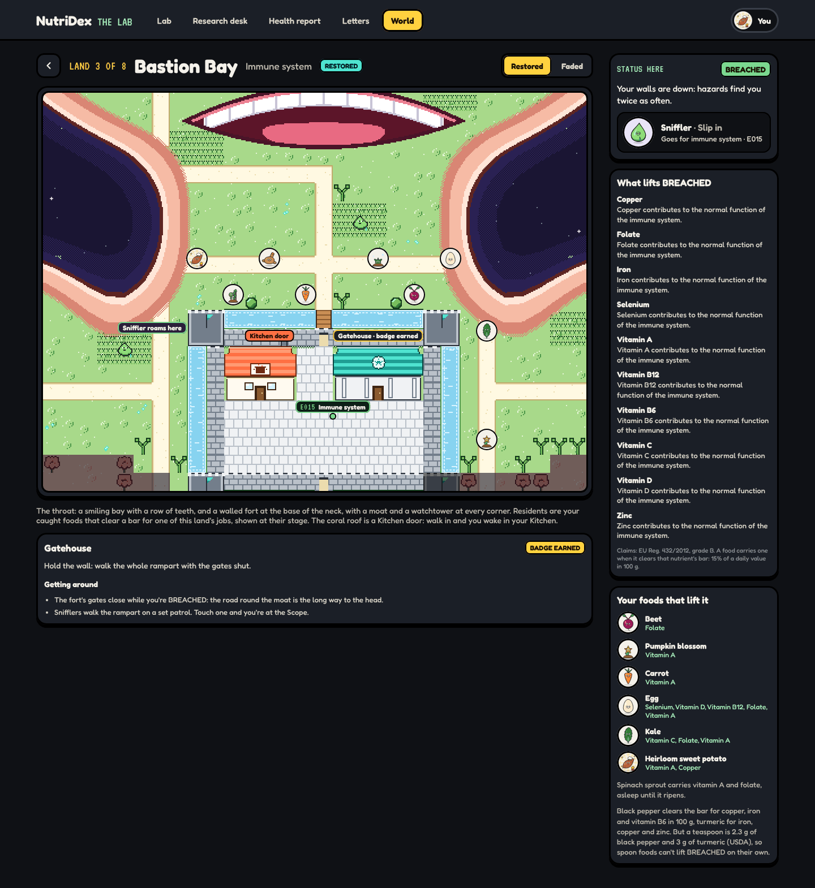

**BUILD NOTE · Bastion Bay (Immune system)**

The throat. The mouth is a smiling bay with a row of teeth; Snifflers come in by it. The fort stands at the base of the neck with gates north (to the head) and south (to the chest). Its gates close while you're BREACHED, so you take the moat road round. Snifflers walk the rampart on a set patrol and start an encounter on contact. Trial: walk the whole rampart with the gates shut; BREACHED doubles the grass encounters on the way.

The map is 30×22 tiles of the one body, at 2×; neighbouring lands are dimmed. District tags are the land's jobs (effects); the one its status hits is ringed in the status colour. Residents are your caught foods at their stage. The Restored/Faded toggle shows both looks.

### Web and Mac · Land 4: Pulse Harbour

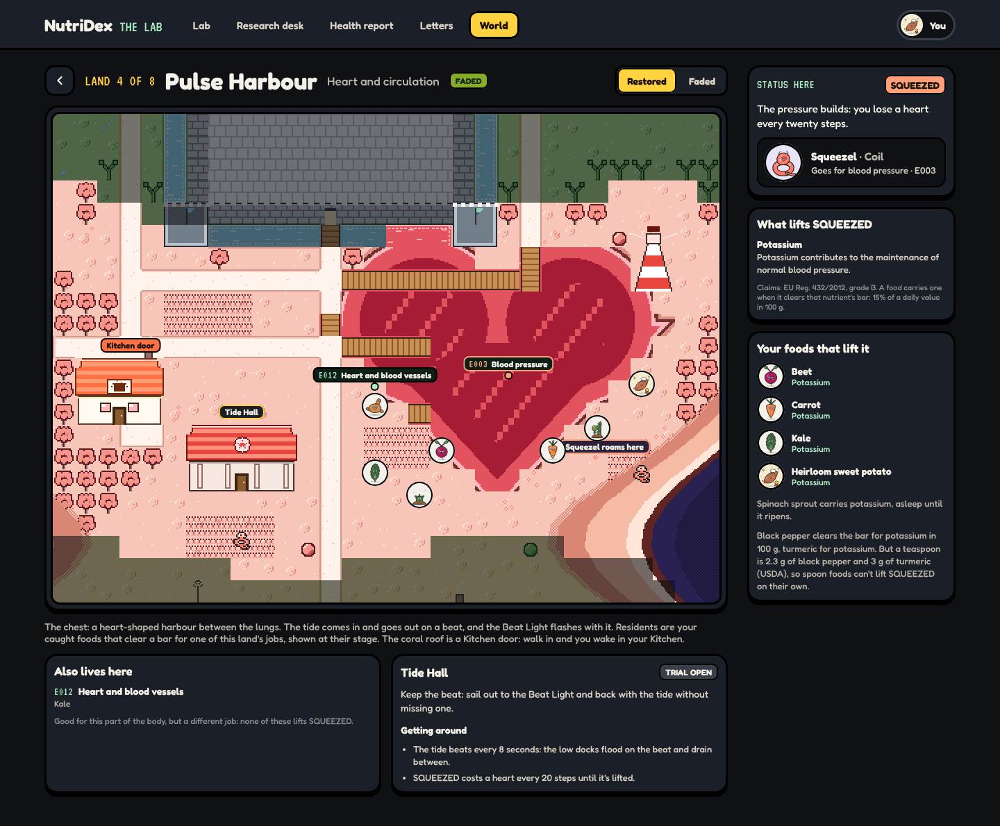

**BUILD NOTE · Pulse Harbour (Heart and circulation)**

The chest. A heart-shaped harbour between the lungs (groves of air-sac trees, the left one bigger). The tide beats every 8 s: low dock tiles flood on the beat and drain between, so you time your crossing, and the Beat Light flashes with it. SQUEEZED costs a heart every 20 steps. Trial: sail out to the Beat Light and back on the beat.

The map is 30×22 tiles of the one body, at 2×; neighbouring lands are dimmed. District tags are the land's jobs (effects); the one its status hits is ringed in the status colour. Residents are your caught foods at their stage. The Restored/Faded toggle shows both looks.

### Web and Mac · Land 5: Calcium Cliffs

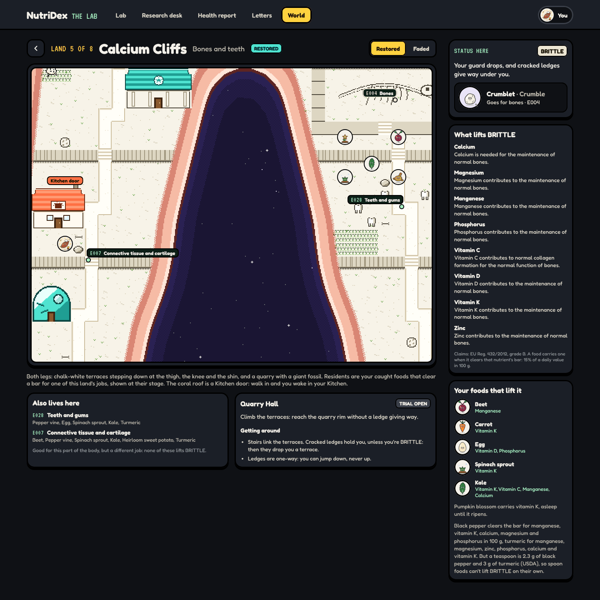

**BUILD NOTE · Calcium Cliffs (Bones and teeth)**

Both legs. Chalk terraces with ledges at the thigh, the knee and the shin, and stairs through each. Cracked ledges hold you unless you're BRITTLE; then they drop you a terrace. Ledges are one-way. The quarry with its fossil is in the right thigh, tooth-shaped stones by the right knee. Trial: climb from the feet to the quarry rim with no ledge giving way.

The map is 30×22 tiles of the one body, at 2×; neighbouring lands are dimmed. District tags are the land's jobs (effects); the one its status hits is ringed in the status colour. Residents are your caught foods at their stage. The Restored/Faded toggle shows both looks.

### Web and Mac · Land 6: Sinew Canyon

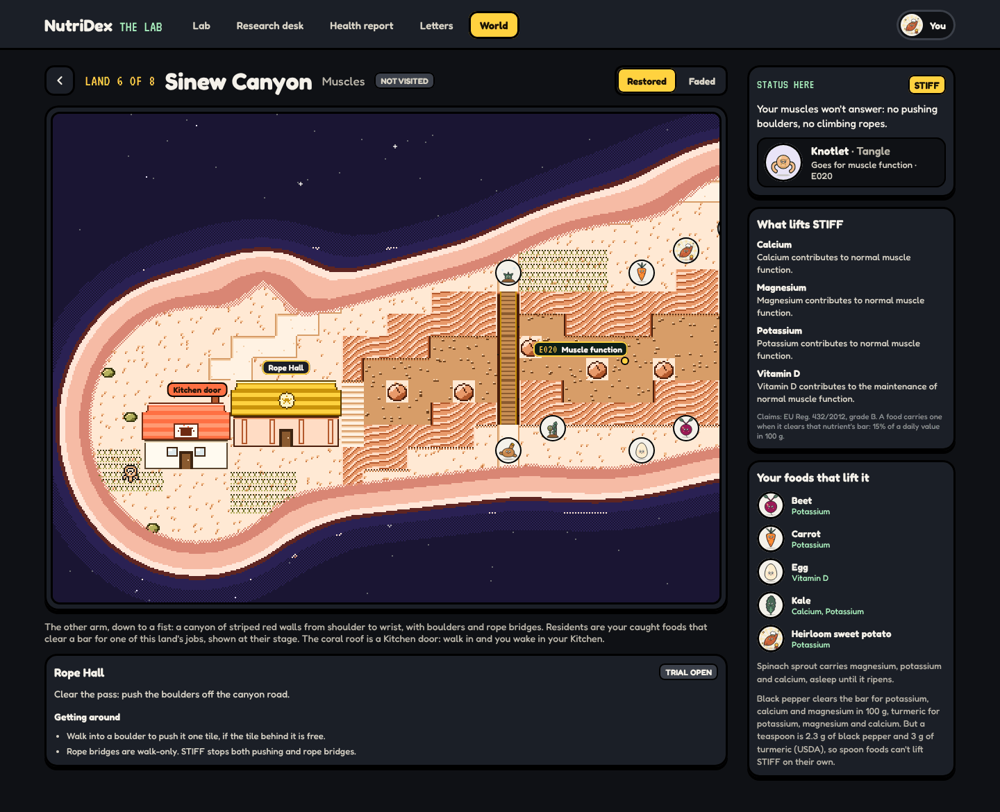

**BUILD NOTE · Sinew Canyon (Muscles)**

The muscle arm, down to a fist. The canyon runs shoulder to wrist with striped walls like muscle fibre; stairs lead in at both ends and rope bridges cross it. Walk into a boulder to push it a tile if the tile behind is free; rope bridges are walk-only; STIFF stops both. The Kitchen door and the Rope Hall stand in the fist. Trial: push the canyon road's boulders clear in 40 moves or fewer.

The map is 30×22 tiles of the one body, at 2×; neighbouring lands are dimmed. District tags are the land's jobs (effects); the one its status hits is ringed in the status colour. Residents are your caught foods at their stage. The Restored/Faded toggle shows both looks.

### Web and Mac · Land 7: Dermis Dunes

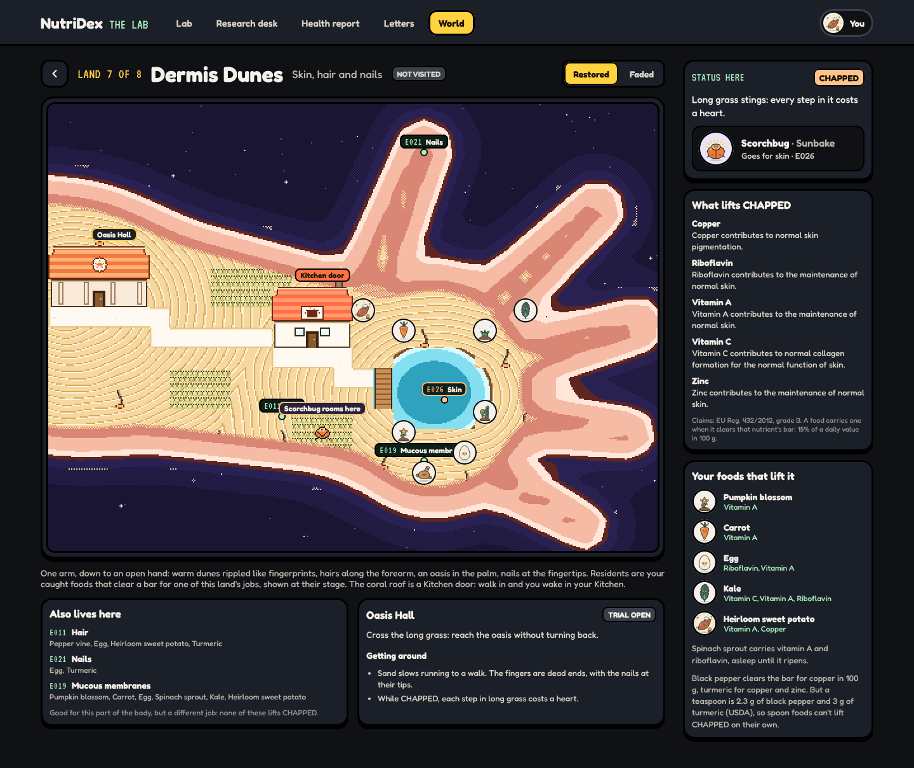

**BUILD NOTE · Dermis Dunes (Skin, hair and nails)**

The skin arm, down to an open hand. Sand slows a run to a walk. Long grass stings while CHAPPED: each step costs a heart. The dunes' ripples are whorls, like fingerprints; hairs grow along the forearm, the oasis sits in the palm, and the fingers are dead ends with nails at their tips. Trial: reach the oasis through the long grass without turning back.

The map is 30×22 tiles of the one body, at 2×; neighbouring lands are dimmed. District tags are the land's jobs (effects); the one its status hits is ringed in the status colour. Residents are your caught foods at their stage. The Restored/Faded toggle shows both looks.

### Web and Mac · Land 8: Crimson Delta

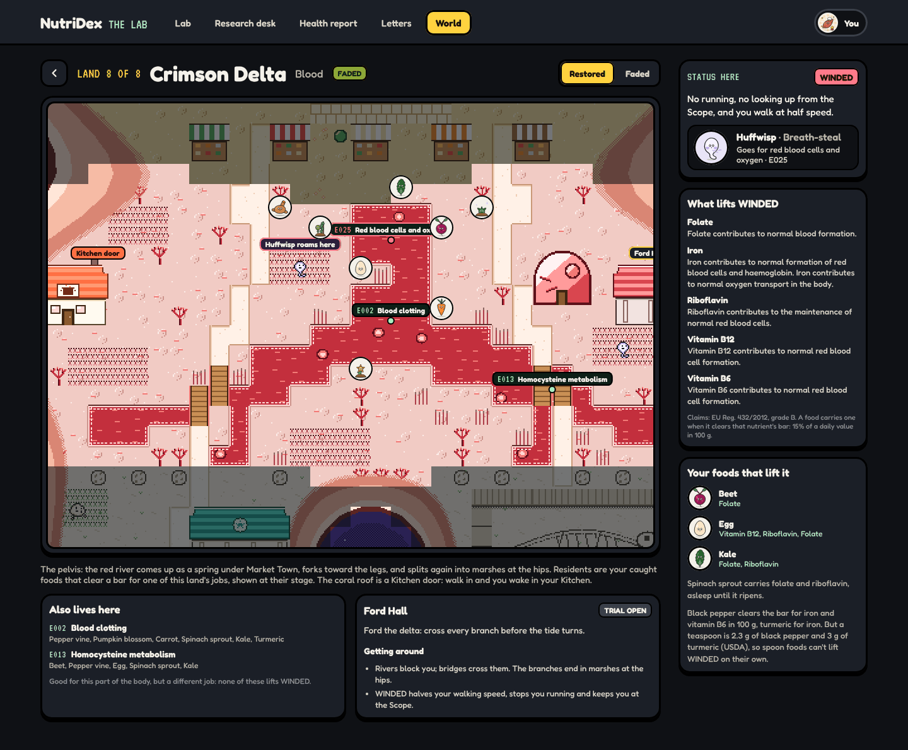

**BUILD NOTE · Crimson Delta (Blood)**

The pelvis. The red river comes up as a spring just under Market Town, runs south as one trunk, forks toward the legs, and splits again into marshes at the hips. Rivers block; bridges cross; red blood cells drift on the water. WINDED halves walking speed and stops running. Huffwisps drift over the water as visible roamers. Trial: cross every branch of the delta before the tide turns (a 90 s timer, shown).

The map is 30×22 tiles of the one body, at 2×; neighbouring lands are dimmed. District tags are the land's jobs (effects); the one its status hits is ringed in the status colour. Residents are your caught foods at their stage. The Restored/Faded toggle shows both looks.

## iPhone

### iPhone · World map

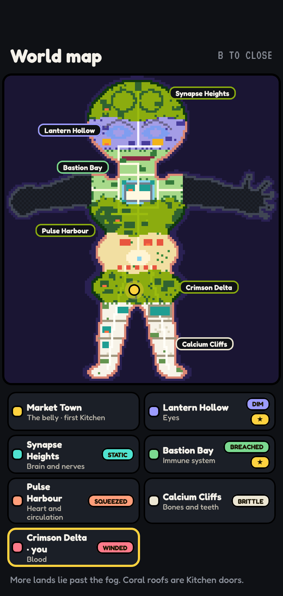

**BUILD NOTE · World map (iPhone)**

Select opens it; B closes. The body at 3 px a tile (378×423). Visited lands are named; fog has no name. Kitchen doors are coral. The dot is you.

The list holds only lands you've entered. It never says how many are left ("more lands lie past the fog" is the most it says). Tap a land for its field notes.

### iPhone · Walking

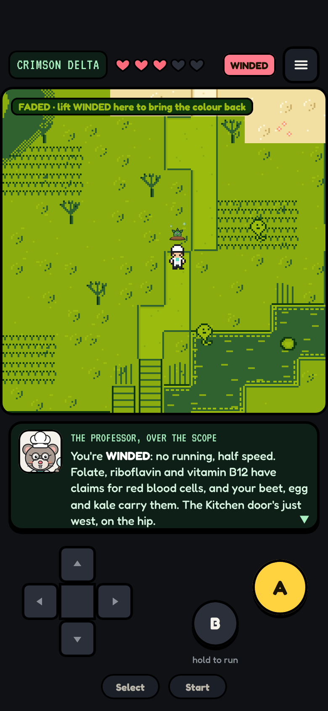

**BUILD NOTE · Walking (iPhone)**

12×12 tiles at 2× (16 px tiles, 32 pt). Movement is tile-locked: 16 frames a tile walking, 8 running (hold B), and a tap turns you before you step. The camera scrolls by whole pixels. The lead food follows one tile behind on your exact path.

HUD: land, hearts, status chips, Start. The dialogue box is HTML/SwiftUI text over the map, never pixels, so Dynamic Type works. It's the Professor, over the Scope: he only names nutrients you've unlocked.

This land is faded: the four greens until WINDED is lifted here once. Skins: HUD, dialogue and controls draw from the skin's tokens; the map is art and keeps its palettes in every skin.

### iPhone · Field notes

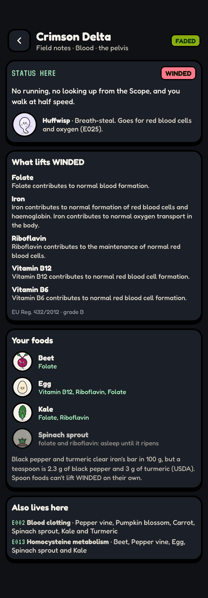

**BUILD NOTE · Field notes (iPhone)**

A land's guide, from your Dex only: the status here, the claim words for what lifts it, your foods that do (and the ones asleep), spoon foods, the land's other jobs and its trial. Nothing uncaught or locked is named. Niacin is locked in this sample, so it isn't listed even though it has claims here.

## iPad

### iPad · The World

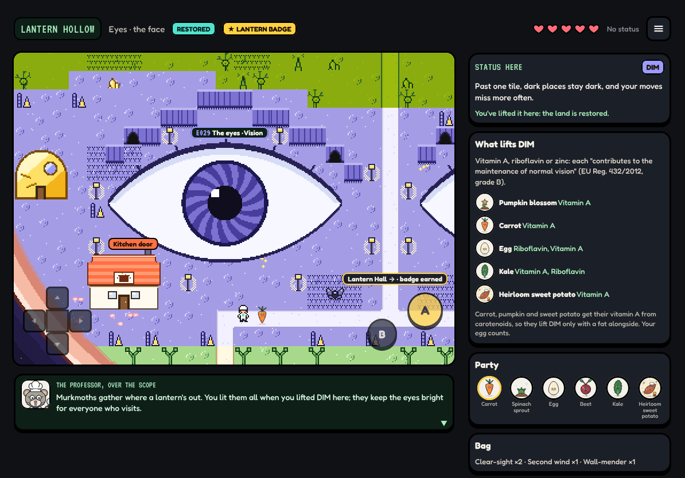

**BUILD NOTE · iPad**

Same game, 24×17 tiles at 2×: here, the left eye of Lantern Hollow, its Kitchen door and a cell. The field guide sits beside the map, so you can read what lifts a status without opening a menu. On-screen controls float over the map's corners at 70% and hide when a controller or keyboard connects. Split View: below 700 pt wide it becomes the phone layout.

## Hazards

### Hazards

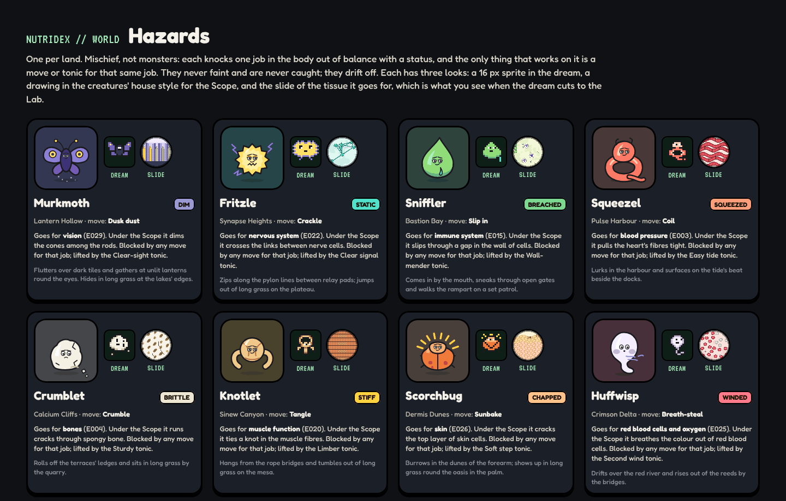

**BUILD NOTE · Hazards**

Eight original hazards, one per land, each tied to the one job its status hits. Three looks each: a 16×16 sprite in the dream (two walk frames), a drawing in the creature house style for the Scope (256 viewBox, 6 px #1B1B1F outline, flat fills, the standard eyes; mischief comes from lids, brows and a smirk), and a 112×112 pixel slide of the tissue it goes for, drawn at 3×.

They never faint, are never caught and never drop anything. A blocked hazard drifts off the slide (0.6 s fade-up) and the cells come back. Visible roamers keep to a route of 4 to 12 tiles, at walking speed, turning at the ends.

## How the World plays

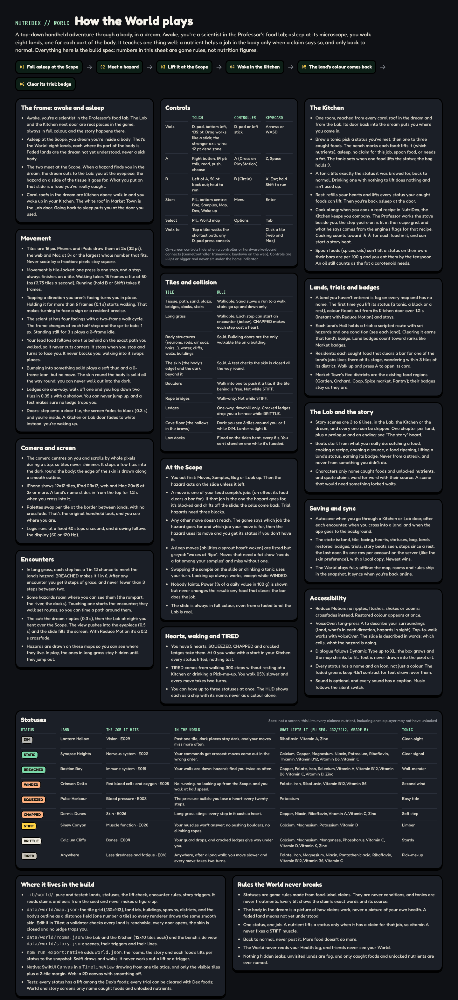

Encounters, the Lab and the Kitchen are on the [[Story|Story]] page.
