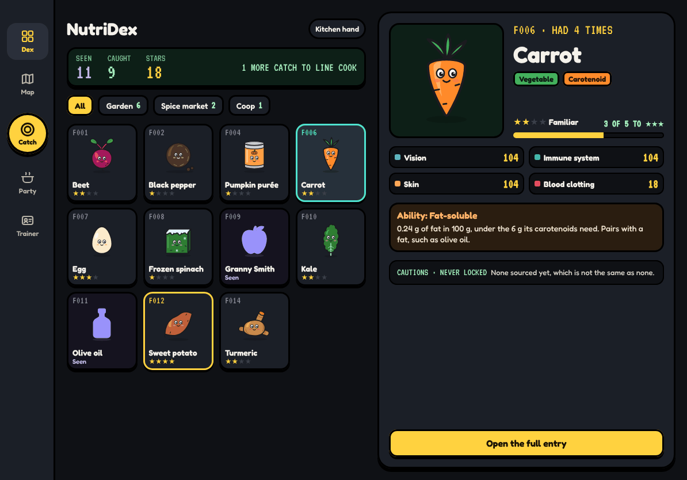
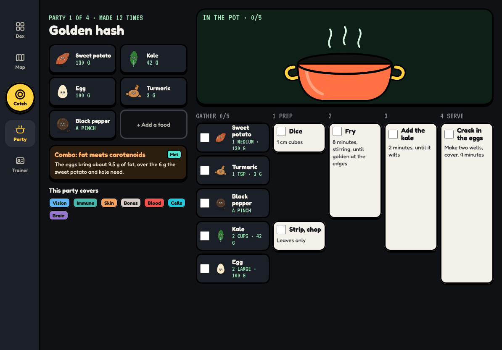
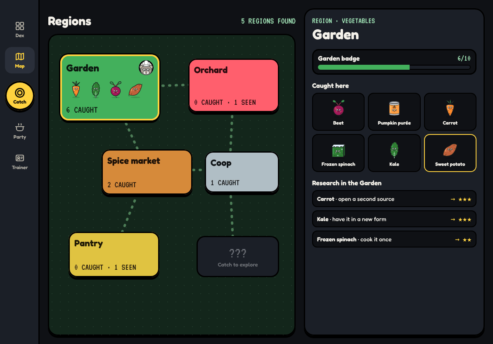
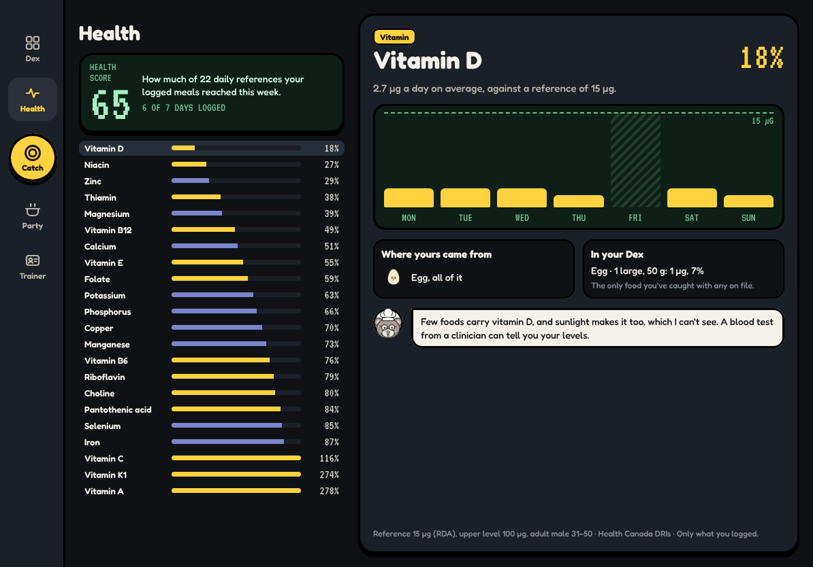

# iPad

_Last updated 2026-11-13. Source: the [design canvas](https://claude.ai/code/artifact/ab065fd4-9113-4368-b970-3f623da00a00)._

The same game laid out for the extra room: a tab rail, and a second pane so browsing never loses its place.

### iPad · Dex with entry panel

**BUILD NOTE · iPad Dex**

Landscape is a split: the tab rail on the left with Catch in it, the grid in the middle, the selected entry on the right, so browsing never leaves the grid. In portrait the entry becomes a sheet.

The same tier rules as iPhone. The grid keeps its scroll position as the panel changes. With a keyboard, arrow keys move the selection, Return opens the full entry, and Space opens Catch.

### iPad · Party and cook, interactive

_Interactive on the canvas: tick a step and its foods go in the pot._

**BUILD NOTE · iPad Party and cook (interactive)**

The party on the left, the recipe grid on the right, with room for every step and no sideways scrolling. Ticking a step tosses its foods into the pot, the same animation as the phone recipe.

Finishing brings in the professor and logs the party as cooked encounters. On iPad this is the kitchen screen: big targets for messy hands, and the screen stays awake while a recipe is open.

### iPad · Regions

**BUILD NOTE · iPad Regions**

The map on the left, the selected region on the right: badge progress, everything caught and seen there, and research tasks for its foods.

Tasks are research only (open a source, have it in a new form), never 'eat more'. Tap a creature to jump to its entry.

### iPad · Health

**BUILD NOTE · iPad Health**

The score and the nutrient list on the left, the selected nutrient's detail on the right, so you can run down the list without leaving it. Same rules as on the phone.

Scanning works on iPad too, but this screen is mostly for reading.
