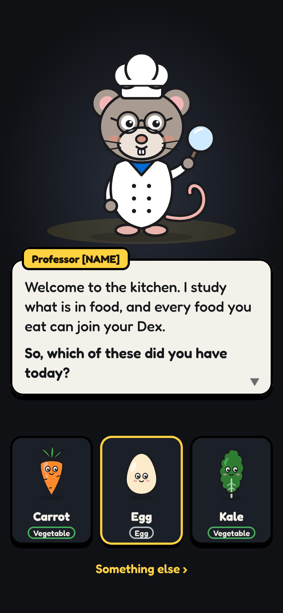
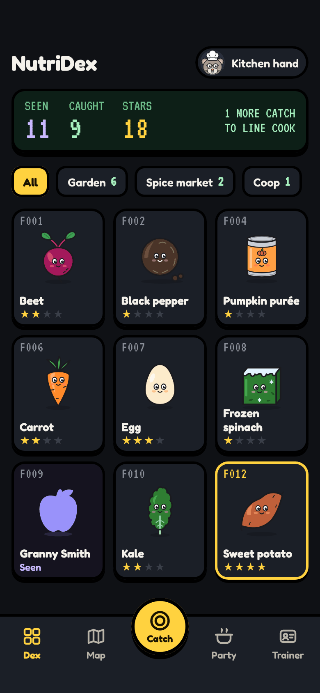
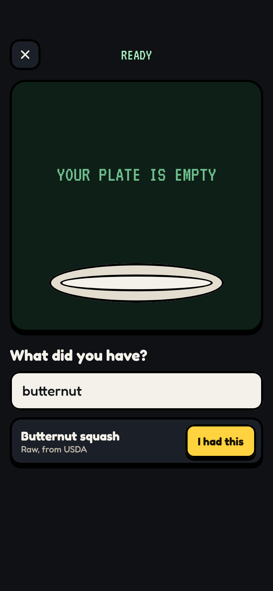
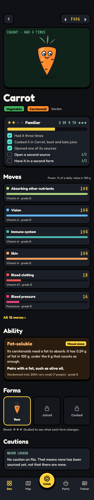
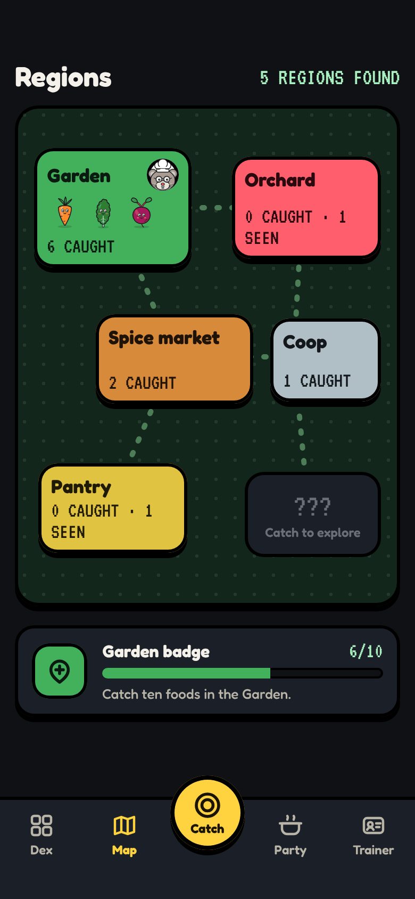
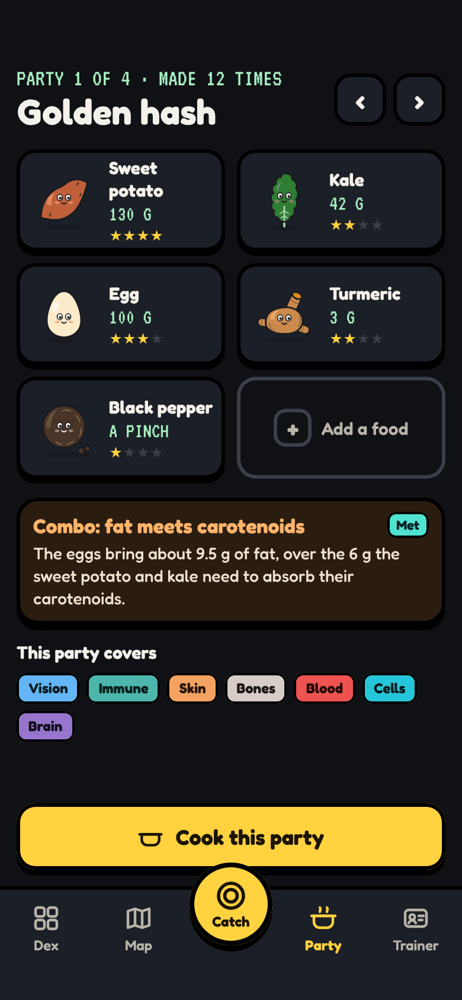
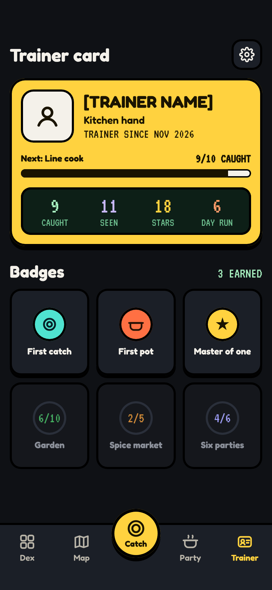

# iPhone

_Last updated 2026-11-13. Source: the [design canvas](https://claude.ai/code/artifact/ab065fd4-9113-4368-b970-3f623da00a00)._

The main application. Every screen below is on the canvas's Game page.

### Start: the professor

**BUILD NOTE · Start**

First launch only, after the disclaimer. The professor speaks in up to three dialogue boxes; a tap moves on and ▼ means there is more.

The three foods are common starters, not a recommendation. Picking one runs the normal encounter, so your first catch teaches the main loop. 'Something else' opens the encounter with an empty field.

Skipping is allowed: you land on an empty Dex where the professor's empty-state line takes over.

### Your Dex

**BUILD NOTE · Dex**

The home tab. The LCD strip shows seen, caught, stars (the sum of every tier) and the next rank.

Region tabs list only regions you have entered. The grid sorts by dex number; each tile shows number, creature, name and stars. Seen tiles are violet silhouettes with their name, since you typed it. A gold frame means ★★★★.

Unseen foods never appear on iPhone or iPad, and no count anywhere says how many are left. Tap opens the entry.

### Encounter, interactive

_Interactive on the canvas: press Play._

**BUILD NOTE · Encounter (interactive)**

The centre Catch button opens this from any tab. Typing searches USDA foods; picking one queues it on the device, so it works offline, and Upload sends the array to app/api/encounters as today.

States: ready, then scanning (the silhouette hops on turning rays for about 1.4 s), then caught (flash, creature springs in, tier bar fills, then any rank-up or badge card).

A food you already caught skips the reveal and shows '+1 research'. Several foods in one upload play in turn, then a summary. Under reduced motion the creature just appears.

### Dex entry

**BUILD NOTE · Entry**

Sections draw by tier. ★: hero, types, top three moves, cautions. ★★: every move and the ability. ★★★: forms and compounds. ★★★★: the professor's notes.

A locked section shows its name and the task that opens it, never a blurred preview of real data. Research tasks are worked out live and tick as you go.

Moves are the effect tiles the engine already makes: power is topShare × 100, colour is the body system. The ability is the absorption flags, wording unchanged. Forms come from prep rows. Cautions always draw, even when empty.

### Regions

**BUILD NOTE · Regions**

A region is a food category: Garden is vegetables, Orchard fruit, Spice market spices, Coop eggs, Pantry oils and grains, and so on.

The board shows only regions where you have caught or seen something; the rest are '???' with no name or count. The professor pin marks your latest catch. Tapping a region filters the Dex.

Each badge has a fixed threshold per region, which says nothing about how many foods live there.

### Party (a recipe)

**BUILD NOTE · Party**

A party is a recipe: up to six foods with grams (three slots at first, six from Line cook).

Combos are engine judgments across members. Here, the party's fat from USDA panel figures is checked against the absorption rule's bar of 6 g. 'Covers' lists the body systems its members' moves reach, never what is missing.

Cook opens the recipe grid. Finishing it logs every member as an encounter with form 'cooked', which counts toward 'cooked it once'.

### Trainer card

**BUILD NOTE · Trainer card**

Rank, progress to the next rank, and stats: caught, seen, stars, and day run (days in a row with a catch). A missed day resets the run quietly, with no guilt message.

Badges: earned ones in colour, the rest show their count. The gear opens Settings, where skins live.

The card follows your account between devices. Name and avatar are yours, and friends you add see your card, and nothing else is public.
